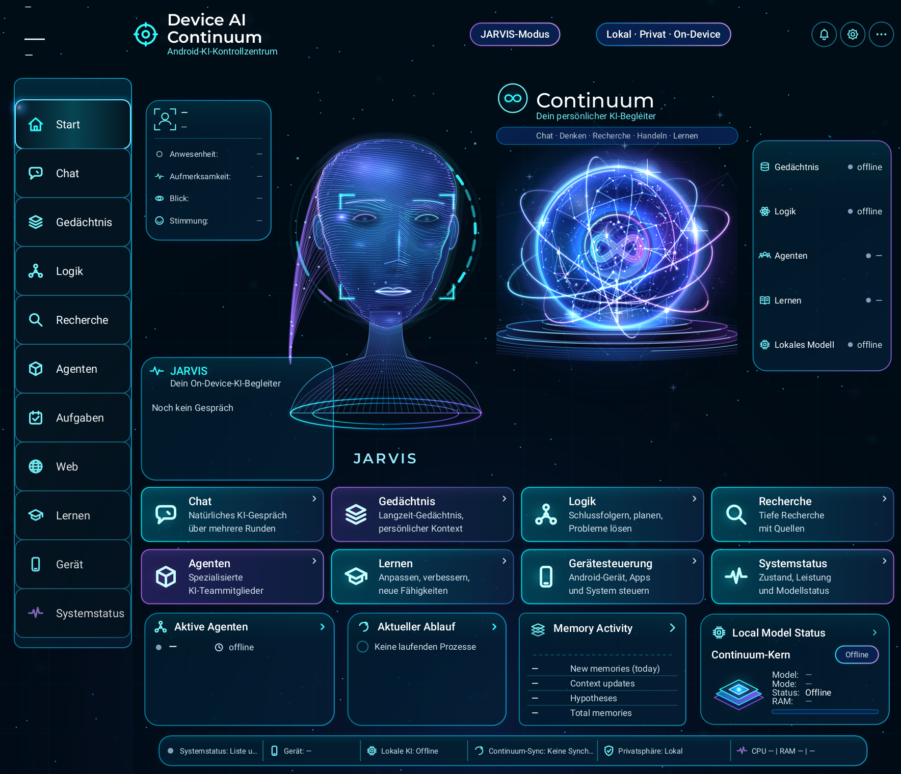

# Jarvis menu / avatar visual evidence — 2026-11-04

## Current preview

`jarvis-menu-avatar-41433ff0.png` is rendered from visual source `41433ff0eafebde1240d09dacec2eea3f9db5100`, at the same 884 × 760 dp viewport and 2× density as the baseline. Later integrated changes concern recovery, chat routing, tests and evidence; these visual painter sources are unchanged.

- One outer navigation rail, visually adjoining buttons, independently tested >=48 dp touch rows.
- Original live avatar and original brain sphere occupy separate portrait/orb regions. The portrait is larger and uses curved luminous fibres. The GLB is unchanged.
- Cyan/violet tile materials, vector icons, soft layered outlines and a static Continuum heading.
- Default idle state: no invented sensor readings, successful tasks, memory counts or brain events. Missing values remain `—` / offline.

This is a **Java2D production-component preview**, not a running Android Activity, emulator or Fold7 screenshot. It shows the Canvas head fallback; it does not validate Filament, Android Skia/AGSL rendering, animation timing or device performance. The native Android glass shader is not executed by this painter. The reference's facial anatomy, surface shading and lighting are not yet reproduced exactly; this is not a pixel-perfect acceptance.

`CurrentJarvisPreview.kt` is the exact render driver (its original comment names the earlier e19 driver; it was reused with the 414 visual classes). `final-provenance.json`, `final-visual-source-provenance.json`, `shared-ui-source-provenance.json` and `final-render.log` bind the image to the actual compiled sources. PNG SHA-256: `293a978812ba26a262f8fc22bd6e0285773a0d549825fba47f2942b6ef92da8d`.

## Integrated verification

The full standard unit run compiled the application and tests from `f14ce8e9d6a3864117a9cea3d325024ab4ff8d9b`: **2416 total, 2397 passed, 0 failures/errors, 19 skipped**, across 434 suites. `combined-unit-summary.json` and the outcome-only `combined-unit-cases.json` record the results and hashes of the original XML. This is separate from the baseline's 2371-test result.

The same complete f14 application classes passed **21 targeted Robolectric UI cases**: 2 avatar preference/viewport cases, 5 genuine-memory-signal cases, 1 existing avatar attach/detach case, 6 recovery-dialog cases and 7 actual Bootstrap chat-caller cases. The last seven use test source `09e235070cb87ed6ff3dd8d327a01659ced0d396`. Four initially failed because their test helper compared the entire `LinearLayout.gravity` to `START`, excluding every assistant row. Comparing its horizontal component repaired the selector; all positive and negative assertions were rerun unchanged. No application correction was required for that test-helper error.

The configured **NewApi-only lint gate reports 0 issues**, and `:app:assembleDebug` succeeds on the same source. The local QA APK is 88,255,113 bytes, SHA-256 `47b3e17e0293d3b48f7f439b292f0143e13f07cb06f4a588dbecf23cfbf6eb75`; it was neither installed nor published. `combined-lint-summary.json` and `combined-apk-summary.json` record those separate gates.

The complete Avatar Activity gate remains open: a bounded 45-second attempt exited 124 before assertions, in `ActivityController.setup/visible → ShadowPausedLooper.idle → Choreographer → ViewRootImpl.performTraversals → Editor.PositionListener / ShadowRenderNode`. A comparable LEGACY baseline attempt blocked in the same traversal path. This does not establish a specific production defect, and component/UI success does not convert it into a passing full-Activity gate. All final gate statuses are recorded in `final-qa.json`; `ui-caller.txt`, `ui-views-and-dialog.txt`, `ui-initial-attempt.json` and `activity-timeout-threads.txt` retain the passing and incomplete UI evidence.

One additional, unchanged existing `ContinuumAdaptiveAvatarNavigationUiTest` host run was bounded to 45 seconds and also exited 124. It reached the real `buildConversationPane` and window attachment, then remained in `JarvisCameraDrift.onTimeUpdate → TimeAnimator/ValueAnimator → Choreographer → ShadowPausedLooper.idle` with repeated invalidation (test line 70). One of five methods started and no method completed. `pane-timeout.txt` and `pane-timeout-threads.txt` preserve this more precise animation/scheduler observation. It is not a passing navigation gate and is not evidence of a proven Fold7 defect or a missing native SDK.

## Baseline

`jarvis-menu-avatar-baseline.png` is freshly rendered from application source `578bdfd12f896cc990bf1a043bc1b248ba3adb6d` (checkout `ad2fa70b`, documentation-only difference), not an old cached screenshot.

- Viewport: 884 × 760 dp, scale 2, output 1768 × 1520 pixels.
- Driver: `BaselineJarvisPreview.kt`; metadata and image SHA-256: `baseline-provenance.json`.
- Actual production Java2D-compatible menu, shell, avatar and orb painters; unknown/default data and static idle state.
- This is a source-derived component preview, **not a running Android Activity or a Fold7 capture**. It does not exercise hit testing, Activity lifecycle, Android Skia, AGSL or Filament.
- Baseline defects are intentionally visible: duplicate navigation, owner card covering the portrait, and the orb squeezed into HEAD rather than its own ORB area.

The native Robolectric Activity capture attempt did not finish; the bounded thread dump blocked inside AndroidTestEnvironment/PackageParser/AssetManager before Activity construction. That is not proof of an Activity layout loop. Functional View tests and Java2D previews are recorded separately; neither substitutes for the native capture gate.

## Evidence archive

`evidence-manifest.json` binds the exported files by SHA-256. The five Gradle/thread-dump text exports only normalize trailing whitespace and final empty lines; their original capture hashes are retained in the manifest. Test outcomes, assertions and stack content are unchanged. Other evidence files retain their captured bytes.
