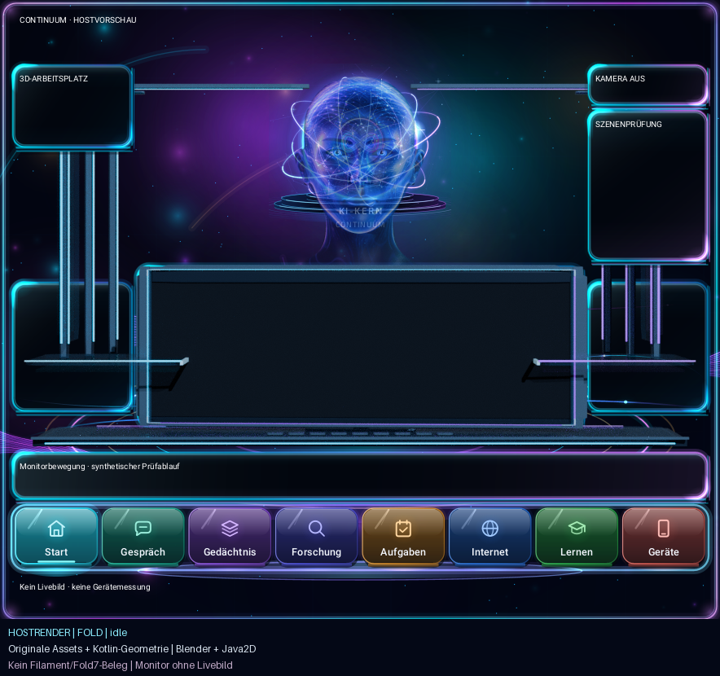

# Holografisches Cockpit – Hostnachweis, 12.11.2026

**Gezeigter Quellstand: `df43ec3580b7939462619505a1e196cf0373879e`.**
Diese Serie zeigt ausschließlich diesen eingefrorenen Zulieferungsstand für
PR #801. Spätere Änderungen des Hauptteams in PR #799 sind nicht enthalten.
Die Bilder sind Entwicklungsrender mit Blender und Java2D.

Öffentlich reproduzierbarer Snapshot:
`097aace1db04d51c13c13be7a88985d9f34fcfcc` in `Ullmann27/device-ai`.
Sein Git-Tree `22c08f103e7a40a9d05cde4c285f4d4e14b35f20` ist byteidentisch
mit dem lokalen Render-Freeze. Die ursprüngliche Quellkennung im Manifest
bleibt unverändert; beim Nachrendern kann der öffentliche Snapshot dienen.

| Zustand | Nachweis |
| --- | --- |
| PORTIERT | Preview-Werkzeuge und verwendete Produktionsquellen im genannten Freeze |
| VERIFIZIERT | Hostexport, Originalasset-Pins, 55 Projektionsprüfungen, sechs Sichtprüfungen und Videoformat bestanden |
| GERÄTEBESTÄTIGT | `NOT_RUN`; kein Filament- oder Fold7-Gerätenachweis |

## Ansichten

| Layout | Ruhe | Übergang | Arbeitsansicht |
| --- | --- | --- | --- |
| Fold, 884 × 760 | [PNG](fold-idle.png) | [PNG](fold-transition.png) | [PNG](fold-working.png) |
| Phone, 411 × 960 | [PNG](phone-idle.png) | [PNG](phone-transition.png) | [PNG](phone-working.png) |

Jedes PNG enthält zusätzlich einen 70 Pixel hohen Herkunftshinweis.

[Monitorbewegung als MP4](fold-monitor-motion.mp4): 49 Frames,
884 × 830 Pixel, `400/7` Bilder pro Sekunde, 0,8575 Sekunden.
Die Produktionsbewegung dauert 420 Millisekunden je Richtung; die Sequenz
enthält Hin- und Rückfahrt sowie einen abschließenden Frame von 17,5 Millisekunden.
Die Abtastung verwendet `CockpitMonitorMotion.flight(...).sample(...)`.
Es gibt keine zusätzliche Zeitkurve. Eine Umkehr während des Fluges wird
in diesem Video nicht gezeigt.

## Quellen und Renderparameter

- Cockpit-GLB: `app/src/main/assets/cinema3d/cockpit-workstation.glb`,
  SHA-256 `3223168a58e5fa51c48bb56ba36aabbf0cdb936025a01d96d4b14e5e0fa023aa`.
  Dieser Hash stimmt mit dem Pin in `FilamentCockpitStage` überein.
- Originalavatar: `app/src/main/assets/avatar3d/continuum-avatar.glb`,
  SHA-256 `c8b88385c73fa01596a5734d20859440b1ecaef06cb1abea6cd7a47e62b08b9a`.
  Prüfung durch den tatsächlichen `AvatarGlbContract`; neutrale Originalpose.
- Produktionslayout, Avatarrahmung, Monitormatrix und Projektion werden aus
  den tatsächlichen Kotlinquellen berechnet. Originalkugel, Aura,
  Energieflüsse und Bedienelemente verwenden die bestehenden Kotlin-Painter
  über Java2D. Vordergrund und Stage folgen den Produktionswerten
  `translationZ = 0.8 dp` beziehungsweise `0.6 dp`.
- Blender 4.3.2, Cycles CPU, zwei Threads, Seed 731, kein Denoising.
  Einzelbilder und Avatar: 32 Samples; Videostages: 16 Samples.
  Insgesamt 57 Renderbilder: 55 Stagebilder und zwei Avatarbilder.

Die größte Abweichung einer Monitorecke gegenüber
`CockpitStageFrame.quad()` beträgt **0,00038074195862236593 Pixel**;
die Abbruchgrenze beträgt 0,08 Pixel. Alle 55 Stageposen bestanden.
Die verwendeten Quellen und Werkzeuge blieben während des Laufes unverändert;
der Quellcheckout war sauber. Die elf im Preview-Manifest erfassten
Ausgabedateien wurden anschließend erneut gegen ihre SHA-256-Werte geprüft.

Alle sechs fertigen Ansichten wurden visuell geprüft: Gesicht und Kinn bleiben
vollständig sichtbar, die Bedienelemente sind lesbar und der Vordergrund
liegt vor der Stage. Die korrigierte dünne Glasauflage und der flache
Monitorfuß zeigen in der Ruheansicht den vorgesehenen Kontakt. Die Prüfung
bezieht sich auf die dargestellte neutrale Avatarpose.

## Reproduktion und Belege

Den öffentlichen Snapshot separat auschecken und den dokumentierten
[Preview-Aufruf](../../../tools/cockpit-workstation/README.md) verwenden:
`--samples 32 --video --video-samples 16`. `--repo-root` muss auf genau diesen
Checkout zeigen; das Ausgabeverzeichnis muss leer sein. Der Hostlauf benötigt
keinen Gradle-Aufruf und verändert keine Produktionsquelle.

- [Quell-, Werkzeug-, Asset- und Ausgabehashes](preview-manifest.json)
- [Blenderparameter und sämtliche Projektionswerte](blender-manifest.json)
- [Kotlin-Posen, Zeitwerte und exportierte Geometrie](scene-export.json)
- [Fold-Layout](fold-layout.json) und [Phone-Layout](phone-layout.json)

## Aussagegrenze

**`HOST_COMPOSITE`**: Die Geometrie und die verwendeten Produktionsberechnungen
sind quellgebunden; Beleuchtung, Materialauswertung und Pixel stammen aus
Blender beziehungsweise Java2D. Filament-Pixelgleichheit ist damit nicht
nachgewiesen. Der Monitor enthält kein Livebild; die Beschriftungen sind
synthetische Prüfinhalte. Android-Lifecycle, MediaProjection, Sprache, Modell,
Geräteframerate und Thermik wurden in diesem Lauf nicht geprüft.
Es wurde keine APK gebaut, signiert oder installiert.

Rückfall: Dieses Evidenzverzeichnis und die Preview-Werkzeuge entfernen;
die Entwicklungsprüfung ist kein Bestandteil der APK.
