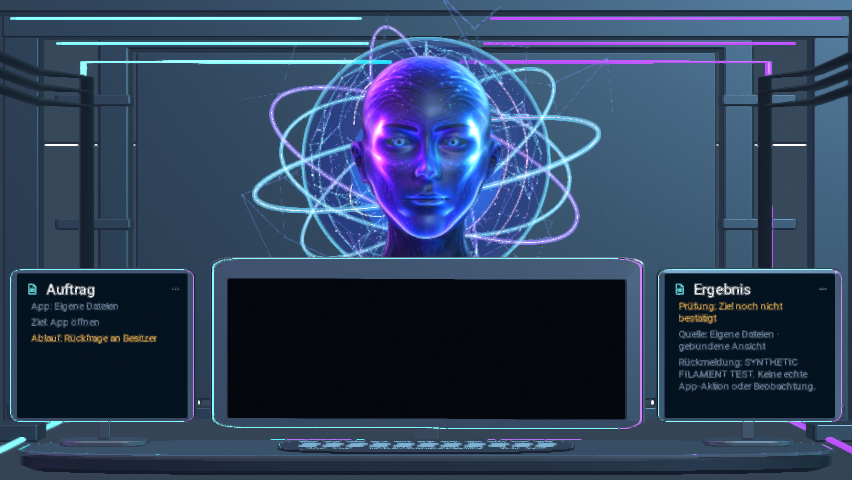

# Code55 candidate 889e06d4

Product source: `889e06d47fffd2230fa5b062dd1f31b65992e728`.
Tree: `bf5f7aaaa0da11cd3d84fba9265174f186a82bc9`.
Canonical integration: [PR #809](https://github.com/Ullmann27/device-ai/pull/809).
This evidence commit does not change the frozen product.

At 2026-11-13 06:04 UTC, full QA remains **IN_PROGRESS**. The unsigned
ARM64 APK and its scoped tests passed. This is not yet an installable owner
update or a completed release acceptance.

| Check | Actual result |
| --- | --- |
| Focused preflight [43372191194](https://github.com/Ullmann27/device-ai/actions/runs/43372191194) | 395 passed, 0 failures/errors/skips |
| APK [43373431159](https://github.com/Ullmann27/device-ai/actions/runs/43373431159) | Both jobs passed; 488 scoped Android cases passed |
| Full QA [43373431089](https://github.com/Ullmann27/device-ai/actions/runs/43373431089) | Node/backend and native PDF/Filament passed; unfiltered Android/UI + lint pending |
| Full Node | 2,474 passed, 37 declared skips; critical subset not counted twice |
| APK source and asset integrity | Independent ZIP/inner APK hashes, 40 Git assets, 2 pinned model files and provenance verified |
| Native pixel capture [43374473925](https://github.com/Ullmann27/device-ai/actions/runs/43374473925) | 24 actual 852×480 RGBA frames, 24 distinct hashes; resource cleanup passed |
| Protected draft signer [43372707832](https://github.com/Ullmann27/device-ai/actions/runs/43372707832) | 61 zero-secret contracts passed; original signing not run |

APK: 103,787,127 bytes, package `at.heinz.deviceai.continuumlocal`,
versionCode 55, versionName 0.3.54, ARM64, minSdk 26 / targetSdk 36,
non-debuggable, 16 KiB alignment passed. SHA256:
`d8fb018277076009631118616775d41688aaad455856c4b5b79b207dc8251332`.
[Source-bound unsigned artifact](https://github.com/Ullmann27/device-ai/actions/runs/43373431159/artifacts/14013238378).

## Actual native pixels

[Two-second native frame sequence](native-synthetic-waiting.mp4) ·
[Complete 24-frame CI artifact](https://github.com/Ullmann27/device-ai/actions/runs/43374473925/artifacts/14014490862)

These pixels come from Android API35 ANGLE/SwiftShader Filament, not Blender
or generated imagery. Harness `2654fe65d53de4d13e3acf11ddbf6316686e6b8e`
([PR #829](https://github.com/Ullmann27/device-ai/pull/829)) changes only test
instrumentation/export tooling; all production inputs match the candidate.

The original avatar, orb/rings, room, workstation and two native context
textures are visible. The fixture supplies a synthetic WAITING_FOR_APPROVAL /
ASK_OWNER state and a direct still avatar pose. The central monitor is black
because no live source is bound. This is not a real Android action, inference,
speech or owner approval. Twelve FPS is the offline export clock, **not a
measured device frame rate**. Full Activity composition, 200% font scale,
Fold7/Android17 and real capture/action/voice remain unverified by this probe.

Host fallback review found header overlap and clipped/ellipsized navigation
captions at 200% font scale. This is an open visual finding. The current native
capture is a technical output proof, not final cinematic-quality acceptance.

## Original-signing handoff

The existing protected route is updated in [PR #828](https://github.com/Ullmann27/device-ai/pull/828).
Protected signer source:
`f232d34c5f28be3375d71f861120d6f673a62157`.
Branch: `chatgpt/code52-owner-signing-20261109`.

After the exact-source full QA has passed and the owner approves this source,
the registered [Code52 manual entry](https://github.com/Ullmann27/device-ai/actions/workflows/continuum-code52-sign-release.yml)
accepts:

| Field | Value |
| --- | --- |
| Branch | `chatgpt/code52-owner-signing-20261109` |
| `source_sha` | `889e06d47fffd2230fa5b062dd1f31b65992e728` |
| `qa_run_id` | `43373431089` |
| `owner_approved_sha` | Same source, only after explicit owner approval |

It discovers successful APK run 43373431159, rechecks all source/QA/artifact
and protected-environment gates before using the existing original key,
and creates an **unpublished, non-latest draft**. It does not publish Latest.
This document does not supply or substitute owner/protected approval.
No original signing, publication, device installation or main merge occurred.

Real computer testing requires Continuum and the target app simultaneously
visible in supported split-screen windows. No background fullscreen autonomy,
physical-device thermal/60 FPS result, Gemma adapter training or automatic
production weight promotion is claimed.
