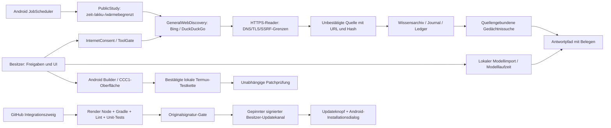

# Continuum · Architektur, Versuchsplan und Freigabegrenzen

Stand: 31.10.2026. Technisches Arbeitsdokument; keine Freigabe und kein Nachweis einer auf dem Gerät ausgeführten Änderung.

## 1. Belegbare Basis

- Originalsignierte, auf dem Besitzergerät gemeldete Haupt-App: `at.heinz.deviceai.continuumlocal`, 0.3.33, `versionCode 34`.
- Gepinnter Update-Host: `https://continuum-owner-v23-release-preflight.onrender.com/continuum-local/latest.json`.
- Android-Releasequellstand vor diesem Entwicklungszweig: `edb331798cfc7b0d5440dc96e36b8e68bd67131b`.
- #298 ist in den Forschungs-/Signierungszweig integriert, nicht automatisch in `main`. #299 ist ein Draft (M10/M11) und kein durch Geräteprüfung belegter produktiver Intelligenzgewinn.
- Dieser Zweig beseitigt einen falschen Abschluss von Forschungsthemen nach Suchanbieter-Ausfällen und verbessert die öffentliche Forschungsdiagnostik. Erst die zugehörige Render-QA und anschließend eine Geräteprüfung können ihn freigeben.
- Keine GitHub Actions; der vorhandene Render-QA-Dienst führt auf exakter SHA Android-Unit-Tests, Lint, Node-Verträge, Backend-Tests und einen nicht installierbaren Release-Assembly-Kandidaten aus.

## 2. Systemarchitektur (aktuelle Wege und unabhängige Gates)

**Wichtig:** Pfeile stellen nur dokumentierte Schnittstellen dar, nicht automatisch erfolgreiche Runtime-Durchläufe. Ohne geladenes lokales Sprachmodell gibt es keine nachgewiesene lokale freie Sprachgenerierung. Der mobile CCC1-Pfad benutzt derzeit Termux; Cloud-GitHub-Arbeit ist davon zu unterscheiden. M10/M11 sind überwiegend kontrollierte Forschungs-/Shadow-Auswertung, nicht automatisch Antwortautorität.

## 3. Reihenfolge nach Abhängigkeit und Risiko

1. **P0 Belegkette:** Ausfall einer externen Suche muss als Transportfehler erscheinen, niemals als dauerhaft abgeschlossener Themenfund. Dauerhafte Hash-Deduplikation, Archivgrenze, Erfassung und Widerruf prüfen; kein Überschreiben bestehender Besitzererinnerungen.
2. **P0 Telemetrie:** Öffentliches Lernen nur als *eingeplant* melden, wenn Freigabe, Internet, Jobregistrierung und Anbieterzustand zusammenpassen. Als *tatsächlich gelaufen* nur gespeicherte Zyklen mit Zeit und Ergebnis ausgeben.
3. **P0 Antwortkette:** Fund -> überprüfbarer Beleg -> Gedächtnis-Retrieval -> Modell-/Fallbackantwort muss auf demselben realen Stand getestet werden. Unbestätigte Webinhalte sind weder persönliche Fakten noch freigegebene Befehle.
4. **P0 Versions-/Signaturkette:** `versionCode` strikt steigend, genaues Release-SHA, originaler Keystore und Zertifikat, gleicher `applicationId`, gehostete SHA-256-geprüfte APK und Manifest-HTTP-Readback. Das aktuelle Gate ist auf Code 34 fixiert; ein neues 0.3.34/Code-35-Release braucht vollständig umgestellte und neu getestete Gates.
5. **M8 Coding-Agent:** Nachgewiesene end-to-end Fehlerreproduktion, isolierter Patch, deterministischer Test, unabhängiger erneuter Test und explizite Übernahme. Keine Behauptung, dass der Android-Builder ohne Termux autonom aus GitHub arbeitet.
6. **M10/M11:** Verifizierter Graph als Shadow, erst nach Holdout-, Konflikt-, Falschbeleg- und Widerrufstests selektiv anschließen. Keine ungeprüfte automatische Promotion in Antworten.
7. **Geräteabnahme:** Installieren/Update, ursprünglicher privater Speicher, Lernjob-Registrierung, reale Web-Domainvielfalt, Modellantwort, Fold7-UI, Akku/RAM/Thermik und Android-Hintergrundpausen auf dem Gerät protokollieren.
8. **Play-Auslieferung:** Für die Store-Veröffentlichung zusätzlich AAB/Play App Signing, Data Safety, Datenschutz, Berechtigungsprüfung und Pre-Launch-/Gerätetests separat abnehmen. `targetSdk 36` ist im aktuellen Gradle-Quellstand gesetzt, aber allein keine Store-Freigabe. **Kritisch:** Das aktuelle Owner-Manifest fordert `QUERY_ALL_PACKAGES` und `REQUEST_INSTALL_PACKAGES` an. Beide sind auf Google Play stark eingeschränkt und erfordern zulässige Hauptfunktionen und eine entsprechende Erklärung; ein selbst installierender Updatekanal ist kein pauschal zulässiger Play-Use-Case. Vor einer Play-Veröffentlichung getrennte Play-spezifische Manifest-/Update-Architektur prüfen, ohne den funktionierenden privaten Originalsignaturkanal zu zerstören.

## 4. Messbare Erfolgskriterien statt Behauptungen

Die drei unabhängigen Zähler dürfen nicht vermischt werden: `A_t` = insgesamt archivierte, gültige Datensätze; `P_t` = dauerhaft protokollierte öffentliche Forschungsversuche; `U_t` = akzeptierte SWB1-Gewichtsrunden. Ein Modell-Update ist kein neuer Webbeleg und ein Webbeleg kein Qualitätsgewinn.

**Web-Neuheitsrate** im Fenster `[t0,t1]`: `eta=(A_t1-A_t0)/(P_t1-P_t0)` nur falls `P_t1>P_t0`; zusätzlich nach Quellentyp und Providerfehlern aufschlüsseln. `eta=0` zeigt Stagnation, aber nicht automatisch einen technischen Defekt: echte Duplikate, Netzwerkfehler, Ressourcenlimits oder Archivfehler müssen separat ausgewiesen werden. Archive enthält auch importierte Quellen; daher beim Experiment zusätzlich den vor/nach jeder Quelle verifizierten Archivzuwachs auswerten.

**Paarweiser Qualitätsvergleich**: gleiche unveränderte Modellbytes, Holdout-Aufgaben, Zufallsseeds, Berechtigungen und Ressourcengrenzen. Für binäre Korrektheitsunterschiede ist die Zahl der discordanten Fälle entscheidend (McNemar-/exakter gepaarter Binomialtest), nicht nur die Gesamtrate. Vor einer Promotion müssen Konfidenzintervalle, Fehlergruppen und Kosten/Antwort berücksichtigt werden. Leere oder zu kleine Holdouts sind `INCONCLUSIVE`, kein `PASS`.

**Gerätebudget**: CPU, verfügbares RAM, Akku, Wärme, Laufzeit und Antwortlatenz vor/nach in vergleichbaren Intervallen messen. Forschungsfortschritt unter System-Pausen nur aus tatsächlichen Laufbelegen schließen; 15 Minuten Periodizität sind keine Echtzeitgarantie. Keine automatischen Berechtigungsänderungen.

**Freigabe-Invariante:** `publish = qa_green_same_sha AND signed_original_cert AND manifest_hash_verified AND version_increased AND owner_approved`. Jeder nicht belegte Term ist `false`. Kein Ersatz durch einen grünen Static-Site-Status oder einen wissenschaftlichen Shadow-Benchmark.

## 5. Externe technische Referenzen

- Android JobScheduler – Ausführungen können systembedingt verschoben werden: https://developer.android.com/reference/android/app/job/JobScheduler
- Android WorkManager – persistente Arbeit mit Nebenbedingungen: https://developer.android.com/develop/background-work/background-tasks/persistent
- Google Play Ziel-API-Anforderungen (ab 31.08.2026 API 36): https://support.google.com/googleplay/android-developer/answer/11926878
- Android App Bundle / APK / Play App Signing: https://developer.android.com/guide/app-bundle/faq
- Play-Richtlinie zur Paket-Sichtbarkeit: https://support.google.com/googleplay/android-developer/answer/10158779
- Play-Richtlinie zu REQUEST_INSTALL_PACKAGES: https://support.google.com/googleplay/android-developer/answer/12085295

## 6. Offene Nachweise

- Echte neue Quellenzahl und Android-Jobstatus des Fold7 nach Installation einer Folgeversion sind noch offen.
- CCC1 benötigt einen aktuellen kontrollierten Termux-Checkout. Der cloudseitige GitHub-Agent ist keine bereits angeschlossene mobile lokale Selbstreparatur.
- Reale Gemma-/lokale Modellantworten sind auf dem Nutzergerät noch nicht belegt.
- Ein Play-Store-taugliches AAB, Play-Console-Abnahme und vollständige Fold7-Regressionstests sind noch nicht nachgewiesen.
