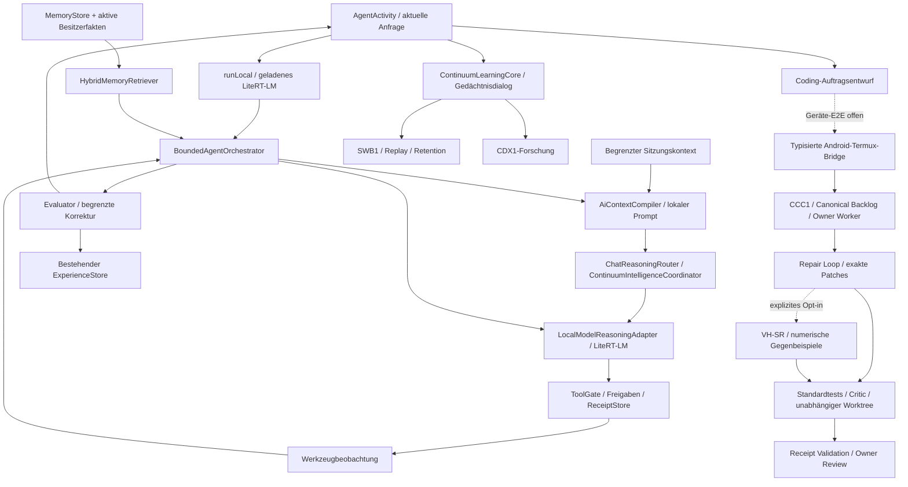

# Device AI Continuum / JARVIS-MO: geprüfte Architektur

Stand: 25.10.2026; Forschungsbranch/PR #133. Ausgangspunkt `821df5d1acf68f0caf10369298352a3589f56a97`; Dialogänderung `c078396b87b671ee2fb6a727fc95d6503cd60815`. Dieses Dokument bewertet Quellverbindungen und ausgeführte Prüfungen, keine Diagrammfarben oder Modulnamen als Funktionsnachweis. Die Besitzer-App wird durch diese Quellarbeit nicht aktualisiert.

## Gemeinsamer Ablauf und tatsächliche Grenzen

Die solide Anschlussstelle für das gemeinsame Gehirn ist der vorhandene `BoundedAgentOrchestrator`, nicht ein neuer Chatbot. `AgentActivity.runLocal` liefert ihm Modell, Gedächtnisse, ToolGate, Evaluator und ExperienceStore. `ChatReasoningRouter` ruft für passende schwierige Aufgaben den bestehenden IntelligenceCoordinator mit begrenzten Kandidat-/Kritiker-/Prüferpässen auf. Deren Text bleibt ausdrücklich unbestätigter Hinweis. Das geladene lokale Modell ist der Dialoganbieter; eine belegte automatische Auswahl mehrerer unterschiedlicher lokaler Modelle ist hier nicht nachgewiesen.

Der neue Sitzungskontext hält bis zu vier lokale Gesprächspaare, höchstens 300 Zeichen Frage und 350 Zeichen Antwort je Paar. Er ist flüchtig, nicht profilglobal, wird bei Sitzungswechsel und nichtlokalen Antworten verworfen und bleibt ausdrücklich unbestätigt. Das verbessert verfügbare Kontextdaten gegenüber dem bisherigen einzelnen Paar, beweist jedoch weder natürliches Sprachverständnis noch korrektes Befolgen der Historie durch ein reales Modell. Lange Inhalte werden begrenzt; vollständige Langzeitdialogkontinuität ist offen.

## Architekturkarte

Quellpfade sind relativ zum Repository. „Verbunden“ bedeutet einen gefundenen Aufrufpfad, nicht eine bestandene Geräteabnahme.

| Baustein / Quellbeleg | Zustand | Wirkliche Verbindung und offene Grenze |
|---|---|---|
| `AgentActivity.kt`, `ui/ContinuumHologramRenderer.kt` | Verbunden, Gerätewirkung ungeprüft | Native Chat-/Forschungs-/Kugel-UI; Unit/Compile geprüft. Keine neue Fold7-Beobachtung, kein Geräte-Fix behauptet. |
| `AgentActivity.runLocal` → `cognitive/BoundedAgent.kt` | Verbunden, Hosttests | Ein vorhandener Agent mit Retrieve/Plan/Model/Tool/Evaluate/Experience/Respond-Zuständen. PLAN allein ist noch kein nachgewiesener semantischer Aufgabenzerleger. |
| `localmodel/LocalModelHost.kt`, `LiteRtLmLocalModelRuntime.kt` | Verbunden, native Inferenz hier ungeprüft | Ein Katalog und Runtime pro Prozess; Wiederverwendung beim Falten/Activity-Neustart. Reales Modell muss importiert/geladen sein; kein heimlicher Cloud-Fallback. |
| `cognitive/ChatReasoningRouter.kt`, `LocalModelReasoningAdapter.kt`, `ContinuumIntelligence.kt` | Verbunden / experimentelles Reasoning | Modellidentität, Frist, Abbruch, Ausgabebudget; Tools in Reasoningpässen abgewiesen. Selbstkritik desselben Modells ist keine unabhängige Wahrheitsprüfung. |
| `cognitive/LocalDialogueQualityGate.kt` | Verbunden, begrenzter Prüfer | Erkennt Leere, Echo und Wiederholung. Beweist weder Wahrheit noch Kausalität. Neuer App-Pfad speichert solche Erfahrungen als PARTIAL. |
| `cognitive/LocalConversationContext.kt` | Neu verbunden / sechs Integrationsverträge geprüft | Vier Paare, sitzungsgebunden; Fallback-Erinnerungen mit Provenienz/Validierung. Prompttext erzeugt keine Berechtigungen. |
| `cognitive/HybridMemoryRetriever.kt`, `MemoryEcology.kt` | Verbunden / getestet | BM25-artiges Ranking, optionale Semantik, Zeit/Vertrauen/Provenienz. Widersprüche können bewusst im Kontext bleiben; Relevanz ist keine Wahrheit. Semantik-Callback ist nicht automatisch ein aktiver neuronaler Retriever. |
| `learning/ContinuumLearningCore.kt`, `ContinuumMemoryDialogue.kt` | Verbunden | Besitzerfakten, Forschungs-/Gedächtnisdialog und Lernaufrufe aus App. `activeOwnerFacts` filtert bestätigte aktive Daten. Nutzerbestätigung und objektive Wahrheit bleiben verschiedene Eigenschaften. |
| `learning/ContinuumLearningExperience.kt` | Verbunden | Dateispeicher, Status/Vertrauen/Provenienz, Hashes, Replay-Auswahl. Widerruf löscht Dialogcache und schließt aktive Fakten aus; kein belegtes Entfernen ihres Einflusses aus bereits trainierten Gewichten. |
| `learning/TrainableSubwordEncoder.kt` (SWB1) | Verbunden und trainierbar | Kleiner trainierbarer Subword-Kern, Intent-/Semantiktraining, begrenzter Replay und Retention-Gates im LearningCore; kein natürliches Sprachmodell. |
| `learning/TinyContextDecoder.kt`, `ContinuumDecoderBridge.kt` (CDX1) | Experimentell, explizite Lernkern-Forschungsaufrufe | Autoregression/gekoppelte SWB-Checkpoints vorhanden; keine bewiesene allgemeine Dialogkompetenz. |
| `learning/lm/LmModel.kt`, `LmRuntime.kt`, `LmCheckpointStore.kt` (LM1) | Implementiert/testbar, nicht aktiver Hauptdialog | Trainer, MinGRU/Transformer, Tokenizer-/Checkpointbindung, begrenzte Generierung. Suche nach Runtime-Aufrufern in Hauptquellen findet Definition/Ladefunktionen, keinen AgentActivity-Aufruf. |
| LM2 | Nicht als aktives Modul nachgewiesen | Kein Treffer für LM2/Lm2 in untersuchten Hauptquellen. Nächste Generation braucht eingefrorenen Corpus, Budget, natürliche Aufgaben und Retention-Test; kein bloßes Umbenennen. |
| EWC/Fisher | Nicht nachgewiesen in aktivem Lernpfad | Suche nach EWC/Fisher/Elastic Weight in Hauptquellen und Control Plane ohne Implementationsbeleg. Replay/Retention nicht als EWC bezeichnen. |
| `cognitive/ExperienceCompiler.kt` | Implementiert, bisher Test-/Forschungsbaustein | Gruppiert wiederholte Task-/Toolsequenzen mit Erfolgs-/Scoregates und Besitzerprüfung. Kein belegter aktiver App-Aufrufer, keine allgemeine Skill-Abstraktion/Anti-Unification. |
| `intelligence/ContinuumCognitiveSpine.kt`, `ResidualSpanResearchAdapter.kt` | Experimentell, Aktivierung nicht nachgewiesen | Quellen-/Spanbindung prüft Zuordnung; beweist nicht die Wahrheit des Zitats. Keine zweite aktive Pipeline daraus machen. |
| `ModelCheckpointStore`, `LmCheckpointStore`, `AgentCheckpointStore` | Teilweise verbunden und getestet | Reale Hashprüfung/Restore für einzelne Modellstände, Agent-Checkpoint an App. Kein atomarer gemeinsamer Snapshot aller Stores, kein signierter Geräte-DAG mit belegter Verfügbarkeit. |
| `.github/continuum/development-backlog.mjs`, `autonomous-teamleader.mjs` | Verbunden / Node-geprüft | CCC1 Canonical Backlog, Claims, feste Task-Grenzen. Kein neuer OMEGA-Worker. |
| `coding-task.mjs`, `coding-provider.mjs`, `scripts/continuum-local-brain.mjs` | Verbunden / Node-geprüft | Commitgebundener Kontext, exakte oldText/newText-Patches, Budget, Temperatur 0 im Patchmodus, ungültige/No-op/nichtanwendbare Antworten abgewiesen. |
| `repair-loop.mjs`, `repair-critic.mjs`, `backlog-repair-worker.mjs` | Verbunden / Node-geprüft | Kandidatentest, zusätzlicher VH-SR-Veto, unabhängiger Worktree, Owner-Review/Receipts. Frischer Worktree ist für allgemeinen Code keine OS-Sandbox. |
| `cefr-repair-ranker.mjs`, `cefr-independent-verifier.mjs` | Experimentell / vorhanden | Vorhandene lernbare CRE1/CEFR-Policy mit beleggebundenem Training; Grundlage für RPK1 statt Duplikat. Nicht neu trainiert in dieser Sitzung. |
| `ContinuumTypedCodingBridge.kt`, Mobile Builder | Verbunden im Quellcode, Geräte-E2E offen | Typisierte feste Aktionen, Receipt-/Patch-/Commitprüfung. PR #135 ergänzt parallele Reviewarbeit; nicht in diesen Branch kopiert. |
| OMEGA AEGIS/Operator-VM/ARCHETYP/Evolution | Architektur, nicht implementiert | Endliche Numerikprüfung ist keine allgemeine neue Skill-VM. Kein autonomer Selbstersetzungsprozess oder Sicherheitsvollbeweis. |

## Forensik, Zweige und Infrastruktur

PR #131/#132 hatten bei eigener Abfrage denselben Head `821df5d1...`, unterschiedliche Zielbranches; beide offen/Draft. #132 war nicht gemergt. Main `190f5eabaa60fc59292b2b80d3086aafd7743a80` hatte 24 eigene Commits gegenüber 2232 ausschließlich auf der Integration. Keine Zusammenführung vorgenommen.

`evidence/branch-inventory.json` enthält 180 Remote-Referenzen mit Vorfahren-/Abstandswerten sowie sechs tiefe Dateivergleiche. `pr-lineage.json` enthält 15 untersuchte relevante PRs. #72/#90 bleiben abweichende Forschungs-/UI-QA-Kandidaten; Synapse-v2 enthält tatsächlich fehlende Quellen. Ein Branch-Vergleich ist keine vollständige Funktionsprüfung aller 180 Zweige. #126 ist kein Vorfahr, einige Verbesserungen sind bereits selektiv adaptiert. `53dfe75a...`/`4f01eab3...`: keine GitHub-Objekte gefunden (422); keine Inhalte erfunden. Parallel entstandene #134/#135 sind sichtbar und bleiben erhalten; #134 baut auf diesem Forschungsbranch auf, #135 auf #134.

GitHub Actions scheitert vor Testbeginn wegen Account-Zahlungs-/Spending-Limit-Annotation, Android wird übersprungen. Das ist kein Testbefund. Lokale Node-/Backend-/Androidprüfungen schließen einen Teil der zuvor fehlenden Gesamtnachweise. Render wurde lesend geprüft; bestehende QA-Dienste verwenden ältere Stände und teils APK-Aufgaben. Keine produktive Dienstkonfiguration verändert, kein Deployment ausgelöst.

## Sicherheits- und Lernprüfung

- Besitzer-ID `at.heinz.deviceai.mentorpaired`, Update 0.3.21/22, Schlüssel, installierte App und Gewichte bleiben unverändert. Kein APK-Task ausgeführt.
- Forschungsmodelle erhalten keine neue Capability. VH-SR-Callback ist vertrauenswürdiger Hostcode, nicht Teil einer Modellantwort; seine Hashes binden Belege, authentifizieren ihn aber nicht.
- Numerische Kandidaten unterliegen der vorhandenen engen Grammatik ohne beliebige Calls/Imports/Objekte/Schleifen. Worker: festes Executable, Heaplimit, Frist, Outputlimit, keine geerbten Zugangsdaten. Node VM allein wäre keine Sandbox.
- Neue OMEGA-Prüfquellen sind gegen automatische Modellpatches geschützt. Unveränderliche Standardtests und Owner-Gates bleiben bestehen.
- Formqualität wird im aktiven lokalen Dialog nicht mehr als bestätigter Erfahrungserfolg archiviert. Bereits historisch erzeugte SUCCESS-Einträge werden nicht automatisch umgeschrieben; Herkunft vor künftigem Skilltraining prüfen.
- Widerrufene Daten benötigen eine durchgängige Abhängigkeitskette bis zu Skills, Caches und trainierten Gewichten. Aktive Faktenfilter allein lösen kein Unlearning.
- AEGIS braucht echte Datenfluss-/Sink-Tests und authentifizierte Rechte. Regex, einzelne ProcessBuilder-Treffer, User-ID-Validierung, Taint-Wrapper oder Datensatzschlüssel allein liefern keinen Gesamtsicherheitsbeweis. Kein Gemini-Code ungeprüft übernommen.

## Forschungsarchitektur und nächste messbare Integration

Der A–F-Schnittstellenplan steht in [PLAN.md](PLAN.md). Reihenfolge nach neuem Besitzerauftrag:

1. Mit eingefrorenem realen LiteRT-LM auf Fold7 fünf Dialogszenarien gegen Baseline fahren: identische Aufgaben und Parameter, frische Sitzungen, semantische Rubrik, Ergebnis-/Kontextbelege, Zeit/Peak-RSS/Thermik. Erfolgsverträge sind vorhanden; native Messung fehlt. Bereits geladenes Dialogmodell verwenden, keinen PC zur Pflicht machen.
2. Den vorhandenen `LocalModelReasoningAdapter`/`AgentModel`-Vertrag für LM1 in Shadow-Auswertung nutzen: gleiche Eingabe, getrennte unbestätigte Ausgabe, keinerlei Tools. Erst LM1-Qualität/Retention belegen; daraus LM2-Architekturentscheidung ableiten.
3. Verifizierte Tool-/Coding-Ergebnisse mit Quellen-IDs an bestehenden ExperienceStore/Compiler geben. Retrieval-only gegen Abstraktion auf neuen Aufgabenfamilien testen; Widerruf invalidiert abgeleitete Artefakte.
4. CEFR/RPK1 unter gleichem Modell-/Zeitbudget: Veto-Mehrwert gegen zusätzlichen Aufwand, echte negative Beispiele, separate Aufgaben. Zeilen-Codec erst mit fairer Modellablation; heutiges exact oldText/newText ist bereits stark gebunden.
5. EIG-SC zunächst als Auswahl unter vorhandenen begrenzten Operationen, Kalibrierung/Enthaltung messen. Dann Checkpoint-Restore über Stores und erst anschließend ARCHETYP-/Evolutionsexperimente. Keine automatische Promotion oder Selbstersetzung.

Erkenntnisstand: mehr nachgewiesene Integrationszuverlässigkeit und bessere verfügbare Dialogkontextdaten; keine gemessene neue neuronale Fähigkeit oder allgemeine lokale JARVIS-Intelligenz. Die Geräte-/Modellabnahme bleibt ein ausdrückliches offenes Gate.
