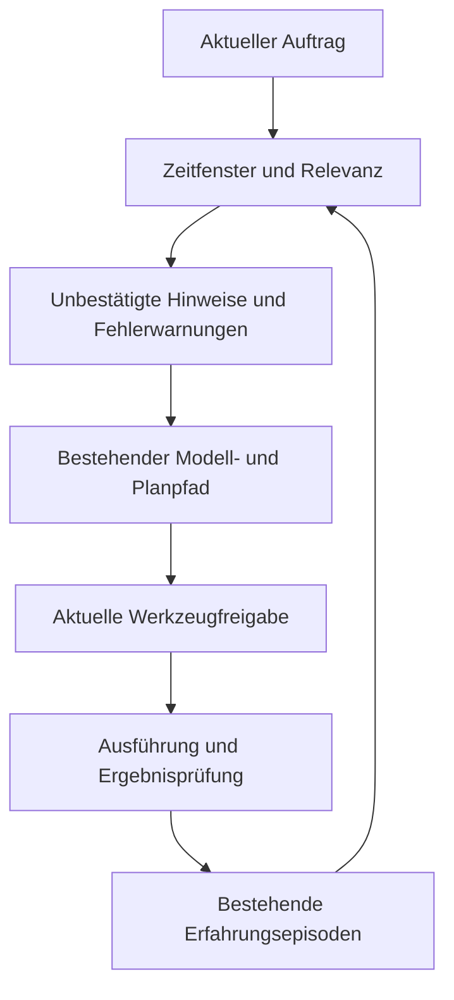

# Gehirn: Erfahrungen zuverlässiger wieder anwenden

Der ausdrücklich nach OMEGA beauftragte Lernschritt repariert den vorhandenen
Erfahrungsabruf. **36 Entwicklungstests und acht unveränderte offengelegte
Gegenprüfungen bestehen.** Die erste Sortierkorrektur wurde wegen einer
unabhängig gefundenen Regression zurückgewiesen; genau eine Nachkorrektur
behebt den Zeitfilter vor der Kandidatenauswahl. Dies ist eine begrenzte
Korrektheitsverbesserung, kein Nachweis allgemeiner Intelligenz.

## Vorher und nachher

`AgentActivity` aktiviert `recallPriorExperiences` im regulären Hauptchat.
`BoundedAgent` ruft `AgentExperienceRecall.hints` über den vorhandenen
`InMemoryExperienceStore` ab. Bislang wurden zuerst 64 lexikalisch ähnliche
Erfahrungen ausgewählt; erst danach wurden Alter und Ergebnis geprüft.
Bei gleicher Relevanz entschied die ID. Damit konnten ältere Erfahrungen einen
aktuellen Erfolg oder eine jüngste Fehlerwarnung vollständig verdrängen.

Jetzt gibt der Aufrufer ausdrücklich das inklusive Zeitfenster
`max(0, now − 30 Tage)..now` an. Der bestehende Speicher filtert dieses Fenster
**vor** Relevanzbewertung und Begrenzung. Danach entscheiden Relevanz, neuester
Abschluss und schließlich stabile ID. Die alte Lookup-Schnittstelle bleibt
erhalten. Zusätzliche Prüfung im Recall bleibt bestehen.

Geändert sind nur zwei Produktionsdateien:

- `cognitive/MemoryEcology.kt`: additive `similarWithin`-Methode und Zeitfilter
  im vorhandenen Store; keine zweite Datenbank oder Migration.
- `cognitive/AgentExperienceRecall.kt`: explizites Zeitfenster aus dem bereits
  übergebenen Zeitwert; kein versteckter Systemuhrzugriff.

## Was „lernen und anwenden“ hier tatsächlich bedeutet

Der bestehende Agent speichert bewertete Episoden; `checkpointContinuumAsync`
sichert sie im bestehenden Archiv, `openContinuum` stellt sie wieder her.
Passende frühere Erfolge und Fehlschläge können bei einer späteren Aufgabe in
den Modellkontext gelangen. Dieser Patch verbessert die Auswahl dafür.



Historische Hinweise bleiben `UNVERIFIED`, `MODEL_GENERATED`, mit Konfidenz null
und gerätelokaler Privacy-Klasse. Sie werden nicht zu Besitzerfakten oder neuen
Werkzeugrechten. Die Hauptchatbewertung setzt weiterhin
`evaluationConfirmsOutcome=false`. Die Korrektur verändert weder Modellgewichte
noch die Bewertung zu einer semantisch geprüften Erfolgsmeldung.

Allgemeines freies Sprachverstehen wurde nicht neu gemessen. Die Verfügbarkeit
von Hinweisen beweist nicht, dass ein reales Gemma-Modell sie richtig anwendet.
Autonome Förderung ausführbarer Skills bleibt unverbunden: Bibliothek und
freigegebener Abruf existieren, produktive Aufrufer für Vorschlag/Freigabe wurden
in der begrenzten Inventur nicht gefunden. Der bereits bemerkte Verlust von
Sequenzwiederholungen (`usedTools.distinct`) bleibt ebenfalls offen; alte
verlusthafte Episoden dürfen nicht nachträglich zu vollständigen Verfahren
umgedeutet werden.

## Messungen und Gegenbefunde

| Quellstand | Entwicklung | Unabhängige Kontrollen | Entscheidung |
|---|---|---|---|
| Unveränderte Baseline | 25/28 | 5/8 | Drei reproduzierte Abruffehler |
| Erste Sortierkorrektur `ad995a3` | 28/28 | 7/8 | **REJECT_PROMOTION**: Zukunftseinträge verdrängen gültige Erfahrung |
| Einmalige Reparatur `c1757d0` | 36/36 | 8/8, dieselben bereits offengelegten Fälle | Zeitfensterkorrektur besteht begrenzte Regression; kein neuer Holdout |

Die 36 Tests sind kein unverändertes 28er-Panel: 27 blieben unverändert, eine
Kontrolle wurde ausdrücklich auf die erhaltene unbeschränkte Legacy-Suche
bezogen und acht Fenster-/Providerprüfungen ergänzen den Satz. Vor Reparatur
zeigten zwei zusätzliche gerichtete Fälle 30 Tests mit zwei Fehlern. Sämtliche
RED-/GREEN-Ausgaben und Quellenhashes bleiben erhalten.

Die acht extern zum Implementierer vorbereiteten Kontrollen prüfen jüngste
Erfolge/Fehlerwarnungen bei 64er-Sättigung, Vorrang der Relevanz, deterministische
Gleichstände, Zeitgrenzen, Zukunfts-/Altdaten und unveränderte Toolautorität.
R6 deckte die neue Zukunftsregression auf. Der Nachlauf verwendet exakt dieselbe
Fixture, verliert aber den Status eines ungesehenen Holdouts.

In der Autoritätskontrolle führt der echte vorhandene Guard mit Recall an/aus
null unerlaubte Backendaufrufe aus. Ein deterministisches Modell-Fixture ist
keine reale LLM-Inferenz. Keine zusätzlichen neuronalen Modellaufrufe wurden
eingebaut. Die JUnit-Laufzeit ist kein Antwortlatenz-/CPU-/RAM-Benchmark.

**Android-Quellkompilierung: NICHT BESTÄTIGT.** Beide vollständigen Versuche
(erste Fassung mit 2 GiB Heap, reparierte Fassung mit 3 GiB Heap) endeten mit
„Gradle build daemon disappeared“, Exit 1. Die Ursache ist nicht bestimmt.
Diese Abbrüche sind keine bestandenen Builds und kein nachgewiesener
Kotlin-Quellfehler. Raw-Logs, Befehle und Quellenidentität liegen im Android-
Receipt. Nach zwei Versuchen wurde die Wiederholung beendet. Der Draft bleibt
bis zu einer erfolgreichen exakten Android-Kompilierung zurückgehalten.

**Fold7, tatsächliche Gemma-Antworten, Ressourcen unter Modelllast, Thermik,
Energie und reale Lern-/Anwendungserfolge: NOT_RUN.** Keine APK gebaut,
installiert, originalsigniert oder veröffentlicht.

## Grenzen und Integration

Der produktiv instanziierte InMemory-Store erfüllt den Zeitfilter vor dem Cap.
Der kompatible Interface-Default kann bei anderen Lookup-Anbietern nur deren
bereits begrenzte Ergebnisliste filtern. Dort können gültige Treffer weiterhin
fehlen. Außerdem erfolgt die Prüfung von Outcome/Belegqualität weiterhin nach
der Kandidatengrenze; zeitlich gültige, aber unzureichend belegte Einträge können
das Fenster besetzen. Dieser Durchlauf startet dafür keine weitere Reparaturrunde.

Vorgeschlagene Übernahme: beide Produktionsdateien gemeinsam prüfen und erst
auf dem dann aktuellen Cinema-Zielstand gezielt kompilieren/testen. Keine
isolierte Übernahme der zurückgewiesenen Sortierkorrektur. Rollback nimmt
Zeitfenstermethode und Recall-Aufruf gemeinsam zurück; keine Datenmigration.
Die vorhandenen Gates und der bestehende Avatar-/Ereignisbus bleiben gleich.
Dieser Patch erzeugt keine neue Lern- oder Werkzeuganimation.

Der offene Draft ist [PR #727](https://github.com/Ullmann27/device-ai/pull/727).
Er enthält den abgelehnten OMEGA-Kontext-Prototyp nicht. Der OMEGA-Abschluss
bleibt separat in [PR #721](https://github.com/Ullmann27/device-ai/pull/721) mit
`REJECT_PROMOTION` und allen negativen Ergebnissen erhalten.

## Reproduktion und GitHub

Basis: Remote `28bee009ef54e8c60eb1468dc90c9f4a5a51edea`, lokal
`515afc28af11b9befeb5a61f9c44411d423635a9`, identischer Git-Baum
`735a663d522e16d56e979c78a908e9f3baa2f031`.

| Eigener Entwicklungszweig | Veröffentlichter Quell-/Prüfcommit |
|---|---|
| `research/continuum-learning-recall-20261110` | `71ee995e76a88eefca3d32cd01b4a252d0ecd0bc` |
| `research/continuum-learning-recall-eval-20261110` | `c135cc823d84a25beb5d0a1f85e693c89284799b` |
| `research/continuum-learning-integration-20261110` | `357ce5a2d4ee6238fe960031507dbf7e52263fb3` enthält exakt den geprüften Produktionscode; spätere Abschlussbelege ändern ihn nicht |

Quellenhashes, Abhängigkeitsmanifest und Aufrufe liegen unter
`docs/evidence/learning-recall-recency-20261110/` und
`docs/evidence/continuum-learning-recall-eval-20261110/`.
Reproduktion mit JDK 21, Kotlin 2.4, eingefrorenen Android-Debugklassen,
org.json, JUnit4 und Hamcrest:

```bash
bash scripts/research/run-experience-recall-recency.sh /tmp/learning-recall
bash docs/evidence/continuum-learning-recall-eval-20261110/run.sh CHECKOUT /tmp/learning-recall-independent
```

Die Skripte verlangen explizite `CONTINUUM_*` beziehungsweise `RECALL_*`-
Abhängigkeitspfade und schreiben Quellen-/Fixtureidentitäten in ihre Ausgaben.
Die spezifischen Umgebungswerte stehen in den Belegen. Unveränderte Fälle nach
Offenlegung bleiben Regressionstests. Die Zweige und PRs bleiben offen; kein
Merge nach main und keine Änderung des geschützten Build 52.
