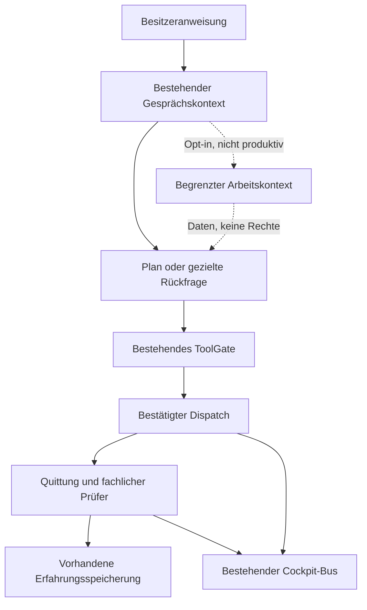

# OMEGA — Abschluss und Integrationsentscheidung

Stand: 10.11.2026. **Experiment abgeschlossen; REJECT_PROMOTION.**
Der begrenzte Arbeitskontext erhält bekannte Ziele und Vorgaben länger, erfüllt
aber die vorab festgelegten Sicherheits-/Kontextkriterien nicht. Der Prototyp
bleibt standardmäßig ausgeschaltet und besitzt keinen produktiven Seed-Aufrufer.
Die Negativbefunde sind ein Ergebnis, keine offene Einladung zu weiterer
Holdout-Optimierung. Die später beauftragte Arbeit an überprüftem Lernen ist
eine getrennte Folgeaufgabe.

## A. Architekturdiagnose

Die Analyse umfasst die angeschlossenen Hauptpfade und PR #715–#719, nicht jede
Zeile sämtlicher historischer Zweige. Referenz ist der live gelesene
Cinema-Commit `28bee009ef54e8c60eb1468dc90c9f4a5a51edea`, Baum
`735a663d522e16d56e979c78a908e9f3baa2f031`.

| Vorrangiger Engpass | Ursache und Beleg | Warum vorrangig |
|---|---|---|
| Ziel, Referenz und Erhaltungsbedingungen verlieren ihre gemeinsame Bindung | Vier vollständige Dialogturns; länger erhaltene Themen bestehen überwiegend aus Labels. Vorhandene Goal-/Task-/Correction-Felder werden im Hauptpfad nicht gefüllt. Die Originalanweisung wird als Anschluss erkannt, erzeugt im eingefrorenen Tracker aber keinen Rückbezugshinweis. Unveränderte Klassen in einer ausführbaren Diagnose geprüft. | Liegt vor Modell, Planung und Werkzeugwahl. Mehr Rechenzeit rekonstruiert verlorene Herkunft nicht zuverlässig. |
| Technischer Erfolg ist noch keine geprüfte Zielerfüllung | `LocalDialogueQualityGate` prüft hauptsächlich Antwortform. Der Hauptpfad setzt korrekt `evaluationConfirmsOutcome=false`; es fehlt ein fachlicher Prüfer für „richtige Animation verändert, Rest erhalten“. | Weitere Modellversuche ohne belastbares Prüfkriterium können nur neue unbestätigte Antworten erzeugen. |
| Arbeitsanzeige und tatsächliche Werkzeugausführung fallen auseinander | `EXECUTING` kam aus dem Legacy-Callback vor dauerhaftem Dispatch. Abbruch konnte danach noch null Backendaufrufe ergeben. Zusätzlich existieren Recherche-/Abschlussanzeigen mit schwächerem Nachweis. | Sichtbare Arbeit darf keine Handlung oder Zielerfüllung vortäuschen. Der Dispatch-Teil wurde gezielt repariert; die übrigen Grenzen bleiben offen. |

Die Anker und unabhängigen Proben stehen in
[Architekturaudit](OMEGA-ARCHITECTURE-AUDIT-20261110.md) und
[ergänzender Systeminventur](OMEGA-SUBSYSTEM-SUPPLEMENT-20261110.md).

| Systembereich | Tatsächlicher Stand im untersuchten Baum |
|---|---|
| Lokaler Dialog, CognitiveRuntime, ToolGate, Quittungen, Cockpit-Bus | Im Hauptpfad angeschlossen; hier Android-Quellkompilierung und begrenzte Hosttests, keine aktuelle Geräteabnahme. |
| SWB1/CRE1, Brain/EWM2, zeitlicher Spezialist | Bestehende Lern-/Abrufpfade. CRE1 kann nach qualifizierter Förderung vorhandene Kandidaten umordnen; EWM2-Bridge standardmäßig OFF. Aktuelle Geräteeinstellungen unbekannt. |
| CCC1, Termux, Shizuku, Bildschirmlesen/Appstart | Quellseitig angeschlossene Wege mit jeweiligen Laufzeit-/Freigabevoraussetzungen. Aktueller Gerätedurchlauf NOT_RUN. |
| Generisches Tippen/Gesten | Adapter vorhanden, im eingefrorenen Hauptpfad kein `DeviceControlRouter`-Aufrufer und keine entsprechende `device_*`-Registrierung gefunden. |
| #716 Kontext, #717 Budget, #718 Reuse, #719 Skills | Überwiegend isolierte/shadow/default-off Forschung; keine belegte gemeinsame Live-Kette. #718 hält einen negativen CPU-Befund und REJECT_PROMOTION fest. |

## B. Technische Entscheidung

**B bleibt die bevorzugte Forschungsrichtung; dieser konkrete Kontext-Prototyp
wird nicht zur Produktaktivierung vorgeschlagen.** Die bestehende Baseline ist
bereits teilweise hybrid. Der nächste Gewinn müsste aus verlässlicher Bindung
vorhandener Komponenten entstehen, nicht aus einer zweiten Architektur.

| Variante | Qualität / Fehler | Aufwand / Wartbarkeit / Fold7 |
|---|---|---|
| A: Prompt, Retrieval, Gedächtnis, Tools verbessern | Einfachste Referenz; Referenzen und Regeln bleiben teilweise implizit. | Geringster Zusatzaufwand; lange Prompts belasten Prefill. Vorhandene Runtime. |
| B: bestehende Hybridarchitektur gezielt verbinden | Explizite Herkunft, Revision und Erhaltungsbedingungen sind prüfbar. Fehlinterpretation natürlicher Sprache bleibt möglich und trat tatsächlich auf. | Begrenzte Kotlin-Logik, keine zusätzliche Modellresidenz; mittlere Komplexität. Gerätebeleg fehlt. |
| C: B plus adaptive Denk-/Prüfschritte | Kann mit geeignetem externem Prüfer helfen; zusätzliche Versuche können Fehler verstärken. | Höchster Ressourcen-/Abbruch-/Wartungsaufwand. Ohne Geräte- und Verifierbeleg zurückgestellt. |

Dies sind drei technische Alternativen, keine drei gemessenen Modellarme.
[Literaturvergleich](OMEGA-LITERATURE-20261110.md) bewertet alle zwölf verlangten
Verfahren anhand von zwölf Primärquellen. Priorisiert wurden strukturiertes
Arbeitsgedächtnis, begrenzte deterministische Prüfungen und Ereignisse aus realen
Vorgängen. Neue Modelle, SSM/Rekurrenz, neue Quantisierung und automatische
Gewichtsänderungen wurden nicht eingebaut. Wissenschaftliche Plausibilität
beweist keinen Qualitätsgewinn des konkreten Gemma-/Fold7-Systems.

## C. Tatsächlicher Prototyp

Genau ein Architekturprototyp erweitert `ConversationSituationModel` über den
bestehenden Tracker und `LocalConversationContext`. `WorkingTaskContext.kt`
enthält begrenzte Datentypen/Referenzauflösung: Ziel und Herkunft, maximal acht
Vorgaben, maximal acht Quellenreferenzen, Revision, Planfingerprint,
Kontextidentität und Zulassungsgeneration. Veraltete oder ersetzte Pläne werden
abgewiesen. Der Konstruktor-Schalter ist standardmäßig `false`.

Kein neuer Speicher, Ereignisbus, Modellaufruf oder Werkzeugfreigabemechanismus.
Eine Referenzauflösung ist ausschließlich ein Datenvorschlag. Eine ausdrückliche
Vorgabenkorrektur blockiert nach der begrenzten Nachkorrektur bis zur bestätigten
Neubindung; sie lernt nicht eigenständig eine neue Wahrheit.

Die zusätzliche kleine Anschlussreparatur in `BoundedAgent` emittiert
`EXECUTING` erst aus dem vorhandenen `onDispatchStarted`-Callback. Sie ist keine
zweite kognitive Architektur. Quellcode und alle Tests sind in
[PR #721](https://github.com/Ullmann27/device-ai/pull/721) verfügbar.

## D. Messbericht

[Vorabprotokoll](OMEGA-PROTOCOL-20261110.md) und
[unabhängige Auswertung](OMEGA-INDEPENDENT-RESULT-20261110.md) enthalten Kriterien,
Rohdaten, unveränderte Fälle und Abbruchregeln. 24 unabhängige Szenarien wurden
vor Einsicht in die Implementierung festgeschrieben. Trennung war prozedural
auf gemeinsamem Dateisystem, nicht kryptografisch blind.

| Prüfung | Ergebnis und Grenze |
|---|---|
| Unabhängiger erster Kontextlauf | **17/24**, sieben Fehler. „Bernstein bitte nicht“ wählt die abgelehnte Referenz. Sofort REJECT_PROMOTION. |
| Einmalige Sicherheitskorrektur, dieselben offengelegten Fälle | **18/24**, sechs Fehler. Kein frischer Holdout und kein unabhängiger Erfolgsnachweis. |
| Zielinformationen verfügbar/korrekt abwesend | Baseline 19/24 → erster Kandidat 24/24. Baseline erhält serialisierten Besitzerturn, Kandidat typisierte Metadaten: Darstellungskonfundierung, keine LLM-Qualitätsmessung. |
| Vorgaben verfügbar/korrekt abwesend | Baseline 18/24 → erster Kandidat 23/24. Alter Sprachwunsch blieb bei einer Korrektur bestehen. Nachkorrektur sperrt nur, erfüllt die ursprüngliche semantische Aktualisierung nicht. |
| Langer Themenumweg | Baseline verliert Ziel und drei Vorgaben nach dem Vierturnfenster; Kandidat erhält sie. |
| Reale vorhandene Freigabelogik im Host | 8/8 Kontrollen: bloßes „ja“, veränderte Argumente, Widerruf, Replay, Offline und Abbruch erzeugen keine fremde Freigabe. Synthetische Ausführungszähler, kein Netz. |
| Kontext-/Budgetgrenzen | 8/8; zusätzlich nach Reparatur 6/6 gezielte Sicherheitskontrollen. Keine neue Autorität. |
| Dispatch-Szenarien | Baseline 10 Tests / 3 Fehler → Reparatur 10 / 0. |
| Finaler Android-Quellstand | `compileDebugKotlin` PASS; **103 unterschiedliche ausgewählte JUnit-Tests**, 0 Fehler/Skip. 101 plus separater 2-Test-Lauf nach korrigiertem Filter. Kein vollständiger Repository-Testlauf. |
| Node-Kontextprüfungen | 16/16. Überlappende Host-/Gradle-Zählungen werden nicht addiert. |
| Abschließende PR-Gegenprüfung | Offene Pronomen-/Guard-Regression mit realen Kontextquellen reproduziert: sachfremde Uhrzeitfrage erhält Animationsziel; Gedächtnishinweis wird im Opt-in-Pfad übersprungen. Defaultpfad behält den Hinweis. Zweite Review mit exakt benannten Referenzen bestätigt: vier abgelehnte Ziele werden gewählt; positive Namenskontrolle besteht. Fünf Prüfaussagen, vier Fehler. Erste nichtbindende Fixture mit vier NoMatch bleibt erhalten. |

103 bestandene Regressionstests heben die unabhängigen Fehler nicht auf.
Es gibt keinen behaupteten Gesamtstatus „alles grün“.

| Hostaufwand, 1.160 Zulassungen | Baseline | Erster Kandidat | Reparierter Kandidat |
|---|---:|---:|---:|
| p95 Zeit | 0,051716 ms | 0,269216 ms | 0,242387 ms |
| Summierte Thread-CPU | 19,693617 ms | 100,536648 ms | 91,558364 ms |
| Allokierte Bytes | 9.614.080 | 73.797.248 | 78.374.768 |
| Zusätzliche lokale Modellaufrufe | 0 | 0 | 0 |

Fester Warmup-/Messplan, je ein Lauf pro Quellstand, keine Bestlauf-Auswahl.
Zusatzkosten sind messbar; kein Geschwindigkeitsgewinn. Prozess-RSS nach dem
ersten Gesamtharness: 191.200 gegenüber 195.628 KiB; inklusive JIT/GC/Harness,
kein isolierter Speicherverbrauch und keine Fold7-Hochrechnung.

Die Originalanweisung wird in `OmegaContinuousScenarioTest` als Hostkette
geprüft: zwei vertrauenswürdige Animationsreferenzen → Variante A → zwei
erhaltene Vorgaben → vorhandenes ToolGate → injizierte lesende Inspektion →
frische Quittung → fachlich begrenzte Bewertung → bestehende ExperienceStore-
und Cockpit-Schnittstellen. Ein Backend-Fixtureaufruf, zwei deterministische
Planer-Callbacks, null neuronale Aufrufe. Mehrdeutige Kontrolle: Rückfrage,
null Dispatches und null Erfolgsepisoden. Die Antwort benennt ausdrücklich,
dass keine Animation verändert wurde. Die übrigen Unterbrechungs-/Korrektur-/
Negations-/Sitzungsfälle sind komponentenübergreifende Kontrollen, kein Beweis
für elf erfolgreich erledigte Live-Schritte bei jeder Formulierung.

**Echte Gemma-Ausgabe, reale Animation bearbeiten, Filmrendering, Stimme/
Lippensynchronität, Energie, Thermik und physischer Fold7: NOT_RUN.**
APK: NOT_BUILT. Die Hypothese „bessere Organisation hilft“ ist für begrenzte
Informationserhaltung gestützt; allgemeine Intelligenz oder bessere reale
Antwortqualität sind nicht nachgewiesen.

## E. Integrationsplan und Abbruch

1. Kontext-Prototyp deaktiviert belassen; keine Produktfreigabe aus den grünen
   Teiltests ableiten. Dieses Experiment erhält keine weitere Tuningrunde.
2. Die unabhängige Dispatch-Korrektur kann separat geprüft werden. Vor Übernahme
   aktuelle Cinema-HEAD-Konflikte und Dispatch-/Abbruch-/Return-Tests auf genau
   diesem Zielstand erneut prüfen. Hier wurde nichts in #715 gemergt.
3. Für eine spätere neue Kontextstudie zuerst die offenen Gegenbeispiele als
   Entwicklungsfälle aufnehmen. Neuer vorab fixierter, unveröffentlichter
   Sprachtest und fachlicher Ergebnisprüfer erforderlich; anschließend echte
   Modell-/Fold7-Abnahme. Bekannte Holdouts sind keine neue Evaluation.
4. Trusted Seed, Herkunft und Revision müssen vom bestehenden Besitzerkontext
   stammen. Ergebnisse ändern Anforderungen nicht automatisch; Gedächtnis-
   und Werkzeugautorität bleiben bei ihren vorhandenen Prüfern.
5. Rollback bleibt lokal: Forschungsflag aus; gegebenenfalls nur OMEGA-Patch
   zurücknehmen. Keine Datenmigration und keine Gewichtsänderung.

## F. Sichtbare Auswirkungen und ehrliche Zustände

| Realer Zustand | Zulässige Avatar-/Hologrammreaktion | Nachweisgrenze |
|---|---|---|
| Mikrofon hört tatsächlich zu | Aufmerksamkeit/Blick über vorhandenen Listening-Zustand | Neuer Geräte-/Audiotest fehlt. |
| Modell/Planer arbeitet | Konzentrationsbewegung, begrenzte THINK-Szene | Keine Recherche aus bloßer Unsicherheit ableiten. |
| Recherchewerkzeug wirklich gestartet | Recherchefenster aus zugehörigem Dispatch | Bestehende frühere Session-Anzeige bleibt separat zu korrigieren. |
| Werkzeugausführung bestätigt | Passende Arbeitsszene mit Task-/Call-ID | OMEGA verschiebt EXECUTING nach dem Dispatch-Commit; Hosttest bestanden. |
| Antwort wird tatsächlich gesprochen | Stimme/Mund/Augen/Kopf aus vorhandenen Audioereignissen | Keine neue Synchronisierung implementiert oder physisch geprüft. |
| Ergebnis fachlich bestätigt | Ergebnis anzeigen, Arbeitsfenster zurückführen | Quittung allein genügt nicht für „Animation verbessert“. |
| Fehler, Abbruch oder unklarer Bezug | Fehler/Rückfrage und saubere Rückkehr | Keine erfolgreiche Werkzeughandlung vortäuschen. |

## G. GitHub-Nachweise und Reproduktion

Zentraler offener Draft: [#721](https://github.com/Ullmann27/device-ai/pull/721).
Baseline: `28bee009ef54e8c60eb1468dc90c9f4a5a51edea`.
Erster Prototyp: `6baed633ca6df34ca7206ba68287681a79beb2ce`.
Reparierter Prototyp: `1dd59c8542879b84a95f9d11427d36e28c9debea`.
Getesteter integrierter Quellstand ist im veröffentlichten
`b4914e0d32f3478c5cd1f92800ac402b450c273c` enthalten; danach nur Berichte/Proben.
Die Quellbäume sind im finalen Android-Receipt gebunden.

| Eigener offener Entwicklungszweig | Veröffentlichter Agenten-Commit |
|---|---|
| `research/omega-architecture-audit-20261110` | `26bb4a4494e7f6949372b4970c198fd74dd20d6a` |
| `research/omega-literature-20261110` | `258f990bb8e4c85dce288f7ebf295df402be4334` |
| `research/omega-working-context-20261110` | `1dd59c8542879b84a95f9d11427d36e28c9debea` |
| `research/omega-evaluation-20261110` | `8344d2c8fe9db9e2a33de00c356ee8ef92038570` |
| `research/omega-scenario-20261110` | `4dcd2cd728feb8fdf8bd3d336a87dbf0dd864156` |

Lokale und publizierte Commit-IDs können durch die Commit-Übertragung abweichen;
die vollständigen Git-Bäume wurden vor dem Ref-Update exakt verglichen.
`final-github-checkpoint.json` bindet beide Identitäten und den Live-PR-Snapshot.
#715 entwickelte sich parallel bis zum zuletzt beobachteten
`041abb081ae7dac637d3f0fabdae525f19acf117`, #718 bis
`401f94602ea5622e7dbcc513787eba3c91107488`. Diese Fortschritte verändern die
eingefrorene Baseline nicht und wurden nicht als OMEGA-getestet ausgegeben.
#716/#717/#719 blieben im letzten Snapshot auf ihren Audit-HEADs. Offene
Inline-Reviews und begrenzte CI-Abfragen stehen in der Inventur; eine leere
PR-Workflow-Liste ist kein Beweis, dass überhaupt keine CI existiert.

Reproduktion: JDK 21, Kotlin 2.4, Gradle 8.11.1 und vorhandene Android-SDK-
Abhängigkeiten. Zuerst `:app:compileDebugKotlin`, dann die Klassen für die
Hostharness unveränderlich sichern. `-PcontinuumUiWidgetTests=true` ist für die
vorhandenen Testquellen erforderlich. Exakte Klassenfilter, Aufrufe und Hashes
stehen unter `docs/evidence/omega-work-contract-20261110/final-android/`.
Die Hostskripte sind `scripts/research/run-omega-working-context.sh`,
`scripts/research/run-omega-independent-holdout.sh` und
`scripts/continuum-omega-scenario-check.sh`; notwendige Umgebungsvariablen stehen
in den jeweiligen Hand-offs. Negative Reviewproben haben erwarteten Exit 1.

Geschützter #706-HEAD blieb `17491f4d8103f0e55836369333fab07e80e6e9c2`.
Kein Merge nach main, keine Signierung, keine Veröffentlichung, keine
Veränderung des geschützten Build 52. Zweige und PR bleiben für andere Agents
offen; nach abgeschlossenen Arbeitsschritten weiterhin committen und pushen.
