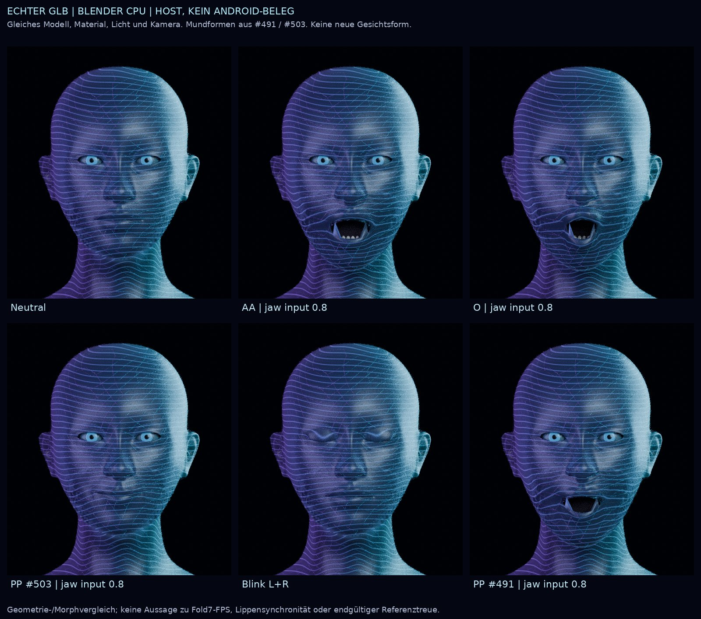

# Drei Forschungsbots für Continuum: erste experimentelle Runde

**4. November 2026 · RESEARCH_SHADOW · ausgeführte Hostexperimente, keine Produktfreigabe.**

Diese Runde beantwortet Heinz' Auftrag mit drei getrennten Forschern: lokale Eigenständigkeit, eigene Sprachmodelle und ein während des Gesprächs animierter Referenzavatar. Relevante frühere Vorgaben wurden mit der bestehenden Architektur und frisch gelesenen PR-Ständen abgeglichen. Die Ergebnisse stammen aus tatsächlich ausgeführten Versuchen; Literatur, Quellbefunde und nächste Hypothesen werden gesondert gekennzeichnet.

Die zentrale Erkenntnis lautet: Die Architektur besitzt bereits verwendbare lokale Bausteine. Das Erfahrungsgedächtnis kann geprüfte Ergebnisse über Neustarts erhalten; der eigene kleine Sprachmodellkern ist tatsächlich trainierbar und funktionserhaltend erweiterbar; der vorhandene Avatar lässt sich durch echte Geometrie- und Sprachzustände steuern. **Eine höhere autonome Reparaturleistung, brauchbare allgemeine Sprachqualität und der fertige Referenzavatar sind damit noch nicht nachgewiesen.**

## Ergebnisse auf einen Blick

| Forschungsbot | Tatsächlich durchgeführt | Ergebnis | Aussagegrenze |
| --- | --- | --- | --- |
| Eigenständigkeit | Unveränderte Node-Suiten: 7 Persistenz- und 44 Recall-Fälle; 9 neue Manipulations-/Neustartproben | 51 vorhandene Tests und 9 zusätzliche Erwartungen bestanden. Neuer Prozess liest denselben Zustand. Selbst behaupteter Modellerfolg wird nicht zum technischen Nachweis. | Synthetische Receipts; keine echte Modellreparatur und kein gemessener Reparaturvorteil. |
| Eigenes Sprachmodell | Original-Kotlin, Originalcheckpoint und 77 originale TRAIN-Dokumente; 18 Diagnoseprompts; 3 Seeds × 3 kurze Trainingsläufe; 3 Wachstumsoperationen | 9 reale Trainingsläufe, 144 Optimierungsschritte, 30.339 optimierte Zielpositionen einschließlich Wiederholungen. EOS-Verhalten ist promptabhängig. Breiten-/Tiefenwachstum bewahrt die geprüfte Funktion. | Zwei wirksame Trainingsbedingungen, weil der Absatzarm eine Nullkontrolle ist. Kein trainiertes 16M-Modell und keine brauchbare Dialogqualität. |
| Avatar | Tatsächliche GLB-Geometrie; getrennte Kotlin-Hostprobes für #491/#503; je 10.000 Wechsel; 6 Blender-Bilder | Gleiches Asset mit 57.000 Dreiecken und 21 Morphzielen. #503 behebt den geprüften PP-Lippenschluss und wiederholte Framezeitpunkte. Je Stand 20.017 Assertions bestanden. | Assertions sind keine unabhängigen Testfälle. Keine Filament-/Fold7-Ausführung, keine Lautsprechermessung, keine Designabnahme. |
| Koordinator | 4 unveränderte Trainingsgate-Suiten; unabhängige Wiederholung der 9 Autonomieproben; Original-Kapazitätsgate auf trainierter Kontrolle; Quellenrekonstruktion | 75 vorhandene Gate-Fälle bestanden; alle 9 Autonomieproben erneut bestanden. Trainierte Kontrolle fällt erwartungsgemäß durch das unveränderte Gate. 50 Quelldateien und 77 TRAIN-Dokumente aus gepinnten Git-Objekten rekonstruiert. | Keine künstliche Summierung dieser unterschiedlichen Prüfarten zu einer vermeintlichen Intelligenzkennzahl. |

Vollständige Berichte: [Eigenständigkeit](autonomy/Report.md), [Sprachmodell](language/Report.md), [Avatar](avatar/Report.md). Rohmessungen und ausführbare Programme liegen unmittelbar daneben.

## 1. Eigenständigkeit: vorhandene Erfahrungen wirksam machen

Der untersuchte CCC1-Pfad besitzt ein dauerhaftes Aufgabenjournal, ein Experience-Ledger und einen technischen Recall. Im Quellcode ist der Recall bereits an den Coding-Orchestrator und dessen Provider angeschlossen. Eine zweite Gedächtnisdatenbank oder ein weiterer produktiver Orchestrator ist für den nächsten Forschungsnachweis nicht erforderlich. Die Wirkung auf eine tatsächlich lokal ausgeführte Modellreparatur bleibt offen.

Der Zusatzversuch erzeugt bewusst synthetische Aufgaben und Receipts. Ein realer neuer Node-Prozess liest dieselben fünf Journalereignisse und dieselbe Zusammenfassung. Die allgemeine Erfolgsmeldung bleibt dennoch vom technischen Recall ausgeschlossen. Ein gesetztes `verifiedModelExecution: true` scheitert an `TECHNICAL_RUNTIME_OBSERVATION_REQUIRED`.

Der wichtigste negative Befund: Wer einen allgemeinen Ledger-Eintrag verändert und dessen ungeschützte Hash-Kette neu berechnet, kann ihn wieder lesbar machen. Die Hash-Kette allein authentifiziert keinen Erfolg. Der so untersuchte allgemeine Eintrag erhält dadurch keine technische Abrufberechtigung. Ein veränderter VERIFIER-Eintrag im kanonischen Journal scheitert dagegen am unveränderten Laufzeit-MAC. Der Versuch behandelt keinen Angreifer, der auch den privaten Zustand und den MAC-Schlüssel kontrolliert.

**Folgerung für den Bot:** Die nächste Forschung muss den vorhandenen Ablauf mit einer echten lokalen Reparatur schließen: fehlschlagender Ausgangstest, tatsächlicher Modellvorschlag, unabhängige Nachprüfung, regulär aufgenommener technischer Nachweis und Abruf nach Neustart. Anschließend werden gleiche unbekannte Fehler mit und ohne Recall verglichen, bei gleichen Modellständen und Budgets. Erst diese Messung kann eine höhere Reparaturleistung belegen. Bloße `COMPLETED`-Zähler reichen nicht aus.

Die Originalmessungen und ihr Umfang stehen in [measurements.json](autonomy/results/measurements.json). Die separate Koordinatorwiederholung steht in [stdout.json](verification/autonomy-root-recheck/attempt-02/stdout.json). Deren erster Start scheiterte vor der Prüfung an einem nicht angelegten temporären Elternverzeichnis; Fehler und korrigierter Start sind erhalten. Das war ein Aufruffehler des Koordinators, kein Fehler der CCC1-Implementierung.

## 2. Eigenes Sprachmodell: Lernen, Ausgabequalität und Größe getrennt prüfen

Der echte Ausgangskern ist ein minGRU-Modell mit 132.160 Parametern, 512 Token, zwei Schichten und Kontextlänge 256. Die vorhandenen 77 Trainingsdokumente ergeben 429.290 bereinigte UTF-8-Bytes in 2.520 Segmenten. Für diesen Versuch wurden ausschließlich die ursprünglichen TRAIN-Dokumente verwendet. Die ursprünglichen VALIDATION-/TEST-Texte wurden nicht eingelesen.

### Der Sofortabbruch ist genauer erklärt

Der feste Kapazitätsprompt endet mit zwei vollständig abgeschlossenen Sätzen. Die Baseline erzeugt darauf 32 Tokens, allerdings mit unbrauchbaren Quellen-/Datumsfragmenten. Nach 16 originalen Trainingsschritten mit Seed 20261104 erzeugt dieselbe kleine Modellvariante dort 0 Tokens und EOS. Entfernt man den letzten Punkt, schreibt sie zunächst einen Punkt und beendet dann. Bei offenen Satzpräfixen schreibt sie weiter.

| Zustand am unveränderten Kapazitätsprompt | p(EOS) | Rang von EOS | Ausgabetokens |
| --- | ---: | ---: | ---: |
| Originalcheckpoint | 0,219758 | 2 | 32 |
| Originaltraining, Seed 20261104 | 0,226541 | 1 | 0 |
| Originaltraining, Seed 20261105 | 0,206406 | 1 | 0 |
| Originaltraining, Seed 20261106 | 0,201666 | 1 | 0 |

Die letzten beiden Zeilen zeigen, warum eine pauschale Erklärung durch eine stark gestiegene EOS-Wahrscheinlichkeit falsch wäre: Die Wahrscheinlichkeit sinkt sogar, gewinnt aber relativ zum anderen Token. Bei greedy Auswahl reicht dieser knappe Rangwechsel. Über die drei Originalarme gab es bei den sechs neuen offenen Präfixen jeweils keinen sofortigen Abbruch. Das widerlegt einen globalen Sofort-EOS-Kollaps für diese kleine Kontrolle. Die großen 6,56M-/9,71M-Kandidaten wurden hier nicht erneut geprüft.

Das bestehende Kapazitätsgate bleibt unverändert. Der Koordinator hat es auf dem neu trainierten Originalarm erneut ausgeführt: **Exitcode 1, `NO_FIRST_TOKEN_OBSERVATION` und `INCOMPLETE_32_TOKEN_WORKLOAD`, drei gemessene Wiederholungen mit jeweils 0 Tokens.** Dieses Resultat ist eine erfolgreiche unabhängige Reproduktion eines negativen Kandidatenbefunds. Es ist keine Freigabe. Siehe [Gate-Rohlog](verification/language-root-recheck/trained-original-capacity.stdout).

### Was die verschiedenen Trainingsmethoden tatsächlich zeigen

Jeder der neun Läufe begann neu beim selben Originalcheckpoint. Drei Seeds ändern die Reihenfolge/Auswahl der Trainingssegmente, nicht die Modellinitialisierung. Verglichen wurden originales EOS-Rezept, zusätzliche Beschränkung auf Absatzenden und diagnostisch entfernte EOS-Trainingsziele. EOS blieb bei jeder Generierung regulär auswählbar.

Der Absatzarm ist in dieser Stichprobe eine echte Nullkontrolle: Bei allen drei Seeds sind Tokenschedules, Verluste und Parameterbytes identisch zum Originalarm. Die EOS-Zielablation bringt am Kapazitätsprompt wieder längere Ausgabe, aber keine nachgewiesene Sprachverbesserung; sie verändert außerdem die Verlustnormalisierung um 0,45–0,80 Prozent. Sie ist kein Produktionsvorschlag. Alle Ergebnisse, einschließlich schlechter Ausgaben, stehen in [results.json](language/run-20261104/results.json) und [analysis.json](language/run-20261104/analysis.json).

### Wachstum funktioniert rechnerisch, Wissen muss gelernt werden

| Operation am Originalcheckpoint | Parameter danach | Größte gemessene Logitabweichung | Identische Generierungen |
| --- | ---: | ---: | ---: |
| Breite verdoppeln | 460.928 | 0,000006676 | 6/6 |
| Breite verdoppeln, paarweises Rauschen | 460.928 | 0,000008583 | 6/6 |
| Eine zunächst neutrale Schicht ergänzen | 181.824 | 0 | 6/6 |

Diese Varianten wurden nicht trainiert. Sie zeigen auf den geprüften Eingaben, dass sich die vorhandene Funktion erhalten lässt; damit bleibt zunächst auch deren schlechte Sprachqualität erhalten. Die in einem anderen Forschungsstand gezählten 16.011.776 Parameter sind weiterhin kein Nachweis eines trainierten, leistungsfähigen 16M-Sprachmodells.

**Folgerung für den Bot:** Zuerst einen kleinen lokalen Lernbestand für klare deutsche Fortsetzungen und überprüfbare Frage-/Antwortaufgaben aufbauen, nach Herkunft und Aufgabenfamilien trennen und vor dem Lauf eine sprachliche Abnahme festlegen. Bei automatisch erzeugten Aufgaben muss ein unabhängiger Prüfer die Antwort kennen, etwa durch ausführbaren Code oder kontrollierte Aufgabenregeln. Eigene ungeprüfte Antworten dürfen nicht allein deshalb als Trainingswahrheit gelten, weil das Modell sie erzeugt hat. Erst danach kleine und gewachsene Modelle bei gleichen Daten und Budgets vergleichen. Eine zusätzliche Diagnose von Abschlussverhalten ergänzt die bestehenden Gates; sie ersetzt sie nicht.

Die neuen 18 Prompts waren vor diesem Lauf festgelegt. Nach dieser Auswertung sind sie bekannte Diagnosefälle und kein unberührter Endtest für künftige Modellwahl.

## 3. Avatar: vorhandenes Modell prüfen und näher an die Referenz bringen

Die vier vorhandenen Originalreferenzen wurden gelesen und visuell geprüft. Maßgeblich bleiben der plastische holografische Kopf, feine Gesichtslinien, dunkles Cyan-/Violett-Cockpit und die Gehirnkugel unter dem Kinn mit etwa 40–50 Prozent Deckkraft. Die bestehende Haupt-App und die beiden Fold7-Zustände bleiben Ziel. Diese Runde implementiert weder ein neues Cockpit noch eine zweite App.

Die untersuchten Stände #491 und #503 enthalten bytegleich denselben GLB: 10.165.644 Bytes, SHA-256 `5f49eface4c828bb7f7564acee751e4d1f232a6e574b5038c6a564de69c9a4a3`. Gemessen wurden 57.000 Dreiecke und 21 Morphziele. Haut und Linien sind an Root/Neck/Head gebunden; der separate Jaw-Knoten bewegt Mundinnenraum und untere Zähne. Eine vermeintliche doppelte Kieferrotation der Haut lässt sich daraus nicht ableiten.

Die vorhandene Verbesserung in #503 wurde tatsächlich reproduziert: Bei PP, der Mundform für P/B/M, und Kieferinput 0,8 schließt der Mund. #491 ließ zusätzlich JawOpen 0,8 und 9,6 Grad Kieferrotation bestehen. Die größte Änderung eines Hautvertex beträgt 24,756 mm; das ist ausdrücklich keine gemessene Lippenöffnungsweite. Ein zweiter Aufruf mit identischem Zeitstempel verändert in #503 die Gewichte um 0; in #491 betrug die größte Änderung 0,857143.



Die Kontaktansicht stammt aus Blender mit demselben vorhandenen GLB, gleicher Kamera und Beleuchtung. Sie ist ein technischer Geometrievergleich. **Die gewünschte Referenztreue ist nicht erreicht:** Augenwirkung, Linienmaßstab, Oberfläche und Mundinnenraum benötigen weitere Arbeit. Ein Standbild mit Vollgewichten beweist kein natürliches Gespräch; Cycles-Bilder beweisen keine Filament-Darstellung auf Android.

Für die Ansteuerung wurden je Quellstand 10.000 deterministische Wechsel und zusätzliche Fälle für Stille, Stop, verspätete Ereignisse, nicht endliche Eingaben und synthetisch vorgepuffertes PCM ausgeführt. Je Stand bestanden 20.017 Assertions. Zwei vorgepufferte 100-ms-Audioblöcke werden im geprüften Signalhelfer erst nach einem künstlich gesetzten Wiedergabeanker sichtbar. Ein realer Lautsprecher wurde dabei nicht gemessen.

Android unterscheidet Syntheseankunft (`onAudioAvailable`) und erwarteten Wiedergabebeginn eines Textbereichs (`onRangeStart`, nur bei Timing-Unterstützung der Stimme). Die vorhandene Ereignis-/Ankerlogik ist dafür ein konkreter Ansatz. Die deutsche Graphem-zu-Mundform-Zuordnung ist jedoch weiterhin eine Annäherung; natürliches Phonemtiming muss separat geprüft werden. [Offizielle Android-Dokumentation](https://developer.android.com/reference/android/speech/tts/UtteranceProgressListener).

Ein weiterer Quellenbefund ist eine veraltete `NOTICE.json`: Ihre Größe und ihr Hash beschreiben nicht den tatsächlich enthaltenen GLB. Der Bericht dokumentiert den Widerspruch. In dieser Forschungsrunde wurde die Produktdatei nicht geändert.

### Vergleich der Herstellwege

| Weg | Einordnung in diesem Versuch |
| --- | --- |
| Bestehenden GLB samt Morphs gezielt überarbeiten | Beste vorhandene Grundlage für plastische Bewegung und Livegespräch. Herstellwerkzeuge und Renderweg sind vorhanden; Neutralform, Augen und Materialien brauchen Referenzarbeit. |
| 2,5D aus der Originalreferenz | Begründete Alternative für hohe frontale Bildtreue mit kleinen Bewegungen. Seitenansicht, Mundtiefe und Rotation bleiben begrenzt. Hier nicht implementiert. |
| Vollständigen Kopf lokal neu herstellen | Blender ist verfügbar, aber ein Neuaufbau garantiert keine bessere Ähnlichkeit. Höherer Rig-/Morph-/Topologieaufwand; hier nicht durchgeführt. |

**Folgerung für den Bot:** Als nächste lokale Herstellrunde den vorhandenen neutralen Kopf und moderate Mundformen frontal und in Dreiviertelansicht direkt gegen die Referenzen prüfen. Für das Livegespräch anschließend auf dem Fold7 denselben Utterance-Verlauf durch Stimme, Anker, Reducer und gezeichnete Gewichte verfolgen, einschließlich Unterbrechung und Displaywechsel. Diese spätere Geräteprüfung benötigt das Gerät; der Host darf ihr Ergebnis nicht vorwegnehmen.

## 4. Quellenstände und wissenschaftliche Einordnung

| Verwendung | Gepinnter Stand |
| --- | --- |
| Gemeinsame Architektur und CCC1 | #491 · `e101e393dd6c80803ac9d9ac91fccd9812c4a18d` |
| LM1, Wachstum und vorhandene Trainingsgates | #492 · `30cd3a89810ed14fa84eca95236d3177e016118d` |
| Vergleich der Avatar-Ansteuerung | #503 · `2582be86c121d7f6d1179c7edc49e979bee8ba9c` |
| Weiterer Kontext, kein stiller Merge | #500 · `0e3685a3bc6cb3a4af61988450371f11e9cb0f3c`; #502 · `6cb9e760f0a16a6f34a8442abf9b79dcf2705799` |

Die Primärarbeiten liefern begründete Forschungsrichtungen, keine übertragbaren Leistungswerte für Continuum:

- [Reflexion](https://arxiv.org/abs/2303.11366): verbales Feedback und episodischer Kontext ohne Gewichtsänderung. Für uns ist daraus ein kontrollierter Recall-Vergleich abzuleiten.
- [SWE-agent](https://arxiv.org/abs/2405.15793): die Schnittstelle zu Repository, Bearbeitung und Tests beeinflusst Agentenleistung. Die vorhandene Werkzeug-/Prüfpipeline ist deshalb selbst ein Forschungsgegenstand.
- [TinyStories](https://arxiv.org/abs/2305.07759): kleine Modelle können auf passend begrenzten Sprachdaten Fähigkeiten erwerben. Die Arbeit ist kein Beleg für universelle Kompetenz eines 16M-Modells und verwendete synthetische Daten externer großer Modelle; diese Dienste wurden hier nicht verwendet.
- [Net2Net](https://arxiv.org/abs/1511.05641): funktionserhaltende Netzerweiterungen motivieren Wachstum ohne Verlust der Ausgangsfunktion. Die konkrete minGRU-Implementierung wurde hier separat numerisch gemessen.
- [minRNNs/minGRU](https://arxiv.org/abs/2410.01201): eine Primärgrundlage der untersuchten kleinen rekurrenten Architektur; publizierte Geschwindigkeiten sind keine Fold7-Messungen.
- [glTF-Morphziele](https://registry.khronos.org/glTF/specs/2.0/glTF-2.0.html#morph-targets) und [Filament](https://google.github.io/filament/main/filament.html): Grundlage für gewichtete Geometrieverformung und den vorhandenen Android-Renderweg.

## 5. Reproduktion und gesicherter Umfang

`restore_sources.py` rekonstruiert die eingefrorenen Quellen und Daten aus einer bereits vorhandenen lokalen Git-Historie, prüft ihre Hashes und kopiert die Forschungsprogramme in ein **neues** Arbeitsverzeichnis. Es lädt nichts herunter und führt selbst weder Training noch Rendering aus. Das primäre Repository muss die historischen Modell-/Tokenizer-/Corpusobjekte besitzen; zusätzliche lokale Datenbanken können die übrigen Quellobjekte bereitstellen.

Aus dem Repository-Hauptverzeichnis:

```bash
python3 experimental/three-bot-research-20261104/restore_sources.py --repo /pfad/zur/lokalen-historie --additional-repo /pfad/zu/weiteren-quellen --output /pfad/zu/neuer-runde
python3 /pfad/zu/neuer-runde/autonomy/run_experiment.py --source /pfad/zum/sauberen-e101-checkout
python3 /pfad/zu/neuer-runde/language/run_experiment.py --kotlin-lib /pfad/zur/gradle-8.11.1/lib
python3 /pfad/zu/neuer-runde/language/analyze_results.py
python3 /pfad/zu/neuer-runde/avatar/scripts/analyze_glb.py
python3 /pfad/zu/neuer-runde/avatar/scripts/run_kotlin_probe.py --kotlin-lib /pfad/zur/gradle-8.11.1/lib
blender -b -t 2 --python /pfad/zu/neuer-runde/avatar/scripts/render_contact.py
python3 /pfad/zu/neuer-runde/avatar/scripts/assemble_contact.py
```

Die Pfade sind Eingabeparameter für die vorhandenen lokalen Werkzeuge, keine automatischen Installationsbefehle. Der Autonomie-Runner verlangt exakt den sauberen e101-Quellstand. Der Sprachmodell-Runner verlangt einen neuen Ausgabeordner und die angegebenen Originalhashes. Python, NumPy/Pillow, Node, Java, lokale Kotlin-Compiler-JARs und Blender müssen bereits verfügbar sein. Vollständige Befehle und Versionsangaben der tatsächlich ausgeführten Runde stehen in den drei Detailberichten und Rohprotokollen.

Gesichert sind die Berichte, Forschungsprogramme, Prompts, Text-/JSON-Messprotokolle, Provenienzmanifeste und die technische JPEG-Kontaktansicht. Die großen reproduzierbaren Zwischenprodukte – neun Diagnosecheckpoints, JARs, kopierte GLB-/Kotlin-Quellen, vollständiger bereinigter TRAIN-Text und einzelne PNG-Renderbilder – werden nicht erneut in diesen Branch aufgenommen. Ihre Hashes und Herstellwege bleiben in den Versuchsmanifesten dokumentiert. Die JPEG-Kontaktansicht ist eine kleinere verlustbehaftete Exportkopie der unveränderten PNG-Montage; ihr eigener Hash ist erfasst.

`PUBLICATION-MANIFEST.json` listet die tatsächlich aufgenommenen Dateien mit Bytes, SHA-256 und Git-Blob-ID. `verification/source-restoration.json` dokumentiert die erfolgreich ausgeführte Eingaberekonstruktion. Ein erster Rekonstruktionsversuch offenbarte lokal unvollständige Objektverfügbarkeit; mit der zweiten bereits vorhandenen Datenbank wurden sämtliche gepinnten Dateien gefunden, ohne Netzwerk-Fetch oder Veränderung eines Quellcheckouts.

## 6. Forschungsauftrag für die nächste Runde

Die drei Rollen bleiben auf dieselbe App und dieselbe Architektur ausgerichtet. Jede neue Runde beginnt mit einem konkreten Quellstand, einer falsifizierbaren Hypothese, festgelegten Vergleichsbedingungen und einem begrenzten lokalen Rechenbudget. Sie endet mit Rohbelegen, negativen Ergebnissen und einer getrennten Entscheidung über weitere Forschung. Die bestehenden Schutzgates und der isolierte Reparaturweg bleiben maßgeblich.

1. **Bot Eigenständigkeit:** reale lokale Reparatur → regulärer technischer Nachweis → Neustart → Recall; danach Recall an/aus auf neuen, zurückgehaltenen Fehlern. Keine zweite Gedächtnisstruktur und kein automatischer Merge.
2. **Bot eigenes Sprachmodell:** Daten-/Formatversuch mit überprüfbaren deutschen Aufgaben auf dem kleinen Kern; Inhalt, Abschluss und tatsächliche Richtigkeit getrennt messen; erst dann Kapazitätsvergleich. Kein Training auf ungeprüften Selbstaussagen, keine EOS-Unterdrückung als angeblicher Qualitätsgewinn.
3. **Bot Avatar:** vorhandenen Kopf lokal näher an die Originalreferenzen bringen; gleiche Morph-/Stop-Prüfungen wiederholen. Die Live-Synchronität anschließend am Fold7 messen; ein Hostbild oder ein Video ersetzt diese Abnahme nicht.

Diese erste Runde ist abgeschlossen. Die Dateien installieren keinen Hintergrunddienst und behaupten keine unbegrenzt weiterlaufenden Bots. Es wurden keine Produktdateien, produktiven Gewichte, Signaturen oder Installationen verändert, kein Main-Merge und keine kostenpflichtige KI- oder CI-Ausführung vorgenommen. Der getrennte Forschungsbranch bleibt der überprüfbare Ablageort.
