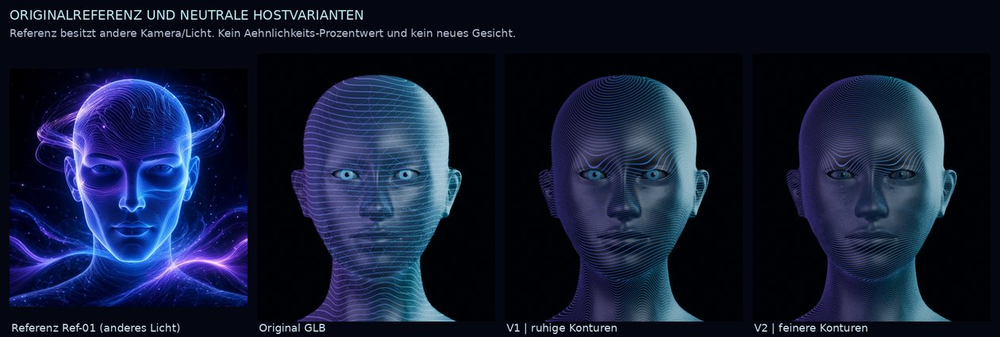

# Forschungsrunde 2: Lernwirkung, Erfahrungsabruf und lokale Avatarvarianten

**4. November 2026 · abgeschlossen · RESEARCH_SHADOW · drei bestehende Forschungsagenten.**

Die zweite Runde erzeugt drei neue, getrennte Ergebnisse: einen gemessenen Kostenbefund am vorhandenen Erfahrungsabruf, vier tatsächlich trainierte kleine Sprachmodellkandidaten mit negativem Aufgabenbefund und zwei lokal hergestellte, visuell geprüfte Avatar-Materialvarianten. Die 75 veröffentlichten Dateien der ersten Runde bleiben unverändert. Diese Ergebnisse sind Forschung; keine Änderung wird dadurch in die App oder einen produktiven Branch übernommen.

## Ergebnisse auf einen Blick

| Bereich | Tatsächlich ausgeführt | Ergebnis | Praktische Konsequenz |
|---|---|---|---|
| Eigenständigkeit | Produktions-Preflight und 260 neue Recall-Messungen in 13 Bedingungen | Modellpfad blockiert; bei 128 synthetischen Erfahrungen liefert `limit=2` denselben Inhalt wie `limit=3` mit deutlich weniger Abrufzeit | Konkrete vermeidbare Prüfarbeit erkannt; keine allgemeine Reparatur- oder Modellbeschleunigung behauptet |
| Eigenes Sprachmodell | Vier native Kotlin-Trainingsläufe, je 256 Schritte und 59.274 Zielpositionen; danach 720 feste Modell-/Prüffälle | Antwortformat gelernt, Besitzzuordnung nicht belastbar gelernt; beide vorregistrierten Erfolgskriterien verfehlt | Gewichtsänderung und Aufgabenbeherrschung ausdrücklich getrennt; alle Kandidaten einschließlich Fehlschlägen erhalten |
| Avatar | Zwei echte Material-/Atlasvarianten, neun kontrollierte 3D-Renderings, unabhängige erneute Herstellung | V2 wirkt dunkler und feiner; beide GLBs bei erneuter Herstellung bytegleich | V2 ist eine überprüfbare nächste Materialbasis; Kopfform, Lidkonturen und Livegespräch bleiben offene Aufgaben |

## 1. Eigenständigkeit: gezielter Abruf spart in einem klaren Fall Arbeit

Der unveränderte Produktionsaufruf `queryPinnedLocalCoding` meldete tatsächlich `BLOCKED_LOCAL_MODEL_UNAVAILABLE`. Fünf erforderliche Angaben zu Modell, Runtime und Bindungen fehlen in dieser Umgebung. Der begrenzte lokale Bestandsscan fand keinen verfügbaren Coding-Runtimepfad. Ein echter neuer Modellauftrag mit Repair→Proof→Neustart→Recall wurde deshalb **nicht ausgeführt**. Weder ein historischer Schlüssel noch die S01-Ausführung wurde wiederverwendet.

Der neue alternative Versuch verwendete die echte Funktion `recallTechnicalExperiences` bei 0, 32 und 128 synthetischen Erfahrungen. Alle historischen Nachweise sind ausdrücklich manuell signierte Vertragsfixtures mit wegwerfbaren Testschlüsseln, keine Modellbeobachtungen. Der Live-Producer `recordTechnicalExperience` wurde nicht durch diese Fixtures ersetzt. 681 aus dem gepinnten Git-Objekt rekonstruierte Quelldateien blieben unverändert.

Der Abschlusslauf umfasst 13 Bedingungen mit je 20 gemessenen Abrufen, 39 Aufwärmaufrufe und eine positive Einzelkontrolle. Datei-/Quellgrenzen und Ausgabelimits wurden kontrolliert. Die ersten elf Erkundungsbedingungen bleiben als eigener früherer Lauf erhalten.

| Bestand | Median mit Limit 3 | Median mit Limit 2 | Inhalt |
|---:|---:|---:|---|
| 32 Erfahrungen | 18,010 ms | 6,574 ms | In allen 20 Paaren identische Text-Hashes und ID-Folgen |
| 128 Erfahrungen | 65,959 ms | 15,344 ms | In allen 20 Paaren identische Text-Hashes und ID-Folgen |

In diesen Fixtures passen nur zwei vollständige Nachweise in das unveränderte Budget von 4.096 Zeichen. Der dritte erlaubte Eintrag erhöht deshalb die Prüfungskosten, ohne zusätzlichen Kontext zu liefern. Das Medianverhältnis bei 128 Einträgen beträgt 4,30. Root hat die Mediane aus sämtlichen Rohmessungen sowie alle gepaarten Hash-/ID-Gleichheiten unabhängig nachgerechnet.

**Keine pauschale Umstellung auf zwei Einträge:** Drei kürzere Nachweise könnten in dasselbe Budget passen und zusätzliche Information liefern. Gemessen wurde der Abruf im Hostprozess, nicht die Qualität einer Modellreparatur, die Geschwindigkeit des Sprachmodells oder die Laufzeit auf Android. `project:null` prüft hier genaue Quellkennung; reale Git-Abstammung gehört nicht zu diesem Versuch.

Vollständige Methode, Rohdaten und Grenzen: [Autonomiebericht](autonomy/Report.md).

## 2. Eigenes Sprachmodell: echte Gewichte verändert, Aufgabenlösung nicht nachgewiesen

### Prospektiver und begrenzter Versuchsaufbau

Der vollständige Versuchsstand wurde **vor dem ersten Training** in Commit [`93b43fa2a80109c64c30335149227ccfcebe0f0a`](https://github.com/Ullmann27/device-ai/commit/93b43fa2a80109c64c30335149227ccfcebe0f0a) veröffentlicht: Protokoll, unabhängiger Antwortprüfer, Daten, Reihenfolgen, Auswertung, Runner, kompiliertes Programm und Vorprüfungen. Der Registrierungs-Hash lautet `b0a70dec25b1b3c8b3aef567f2e03ac4667b886555e6bb3fff7b8fa8426eedcc`.

Die konkrete Aufgabe ist **Besitzzuordnung**: Zwei Gegenstände gehören zunächst bestimmten Personen A–D; danach folgen null, eine oder zwei gültige Übergaben. Das Modell soll beantworten, wer den erfragten Gegenstand am Ende besitzt. Die frühere vorläufige Aufgabenbeschreibung mit möglichen Gegenstandorten wurde vor dem Training durch dieses genaue Protokoll ersetzt.

512 Trainingsfälle, 48 Entwicklungsfälle und 96 Testfälle wurden deterministisch erzeugt. Ein separater textlesender Interpreter prüft die Antwort. Ganze Objektpaare sind zwischen den Mengen getrennt; Objektwörter, Satzgrammatik, Antwortalphabet und sechs Ereignisfamilien sind gemeinsam. Das ist ein enger Kombinationsvergleich, kein Test unbekannter Sprache oder einer allgemeinen Weltsimulation.

Alle vier Kandidaten starten von demselben Originalcheckpoint mit 132.160 Parametern. Verglichen wurden gemischte Reihenfolge und eine Reihenfolge von einfachen zu schwierigeren Fällen, jeweils mit zwei vorab festgelegten Reihenfolge-Seeds. Beide Methoden sehen dieselbe Datenmultimenge. Pro Kandidat: 256 Schritte, Batchgröße 4, zwei Durchläufe durch die 512 Beispiele, insgesamt 59.274 Zielpositionen. Modell, Tokenizer, Optimierer und Kapazitätsgate stammen unverändert aus dem bestehenden Kotlin-Kern. Keine externe KI-API wurde zur Erzeugung der Modellantworten oder zum Training verwendet.

### Tatsächliche Testergebnisse

| Modell | Freie richtige Antwort | Auswahl A–D nach Antwortwahrscheinlichkeit | Kritische Ablenkfälle, frei | Unverändertes Kapazitätsgate |
|---|---:|---:|---:|---|
| Original | 0/96 | 24/96 | 0/32 | PASS |
| Gemischt, Seed 202611041 | 24/96 | 24/96 | 8/32 | FAIL |
| Stufenweise, Seed 202611041 | 24/96 | 24/96 | 8/32 | PASS |
| Gemischt, Seed 202611042 | 27/96 | 27/96 | 8/32 | FAIL |
| Stufenweise, Seed 202611042 | 24/96 | 24/96 | 8/32 | FAIL |

Zum Vergleich erreicht die Regel „ursprünglicher Besitzer“ 32/96 und die Regel „zuletzt genannte Person“ 59/96. Letztere scheitert allerdings an allen 32 eigens eingebauten kritischen Ablenkfällen. Auch auf dieser kritischen Teilmenge bleiben die trainierten Modelle bei 8/32. Kein Kandidat erfüllt das festgelegte Erfolgskriterium; das gilt für freie Antwort und bedingte Auswahl getrennt.

Die Rohantworten erklären die vermeintliche Verbesserung: Zwei Kandidaten antworten in allen 96 Testfällen `B`, ein weiterer immer `C`. Der vierte verteilt seine Antworten auf 59-mal `C` und 37-mal `D`. Das Antwortformat hat sich deutlich geändert, die richtige fallabhängige Zuordnung ist damit nicht belegt. Bei allen vier Kandidaten änderten sich tatsächlich alle 132.160 Gewichtspositionen. Der gesamte Studienlauf einschließlich Gates und Auswertung dauerte auf diesem Host 92,63 Sekunden; dies ist keine Android-Laufzeitangabe.

Drei Kandidaten verfehlen den unveränderten 32-Token-Kapazitätsarbeitsumfang. Ein frühes EOS liefert für dieses Gate keine vollständige Messlast. Das Gate misst diesen Arbeitsumfang und keine Besitzkompetenz; sein PASS beim übrigen Kandidaten macht dessen 24/96 nicht zu einer guten Aufgabenleistung. Kein Kandidat wird promoviert oder weitertrainiert. Auch die Diagnose der FAIL-Kandidaten war vorab ausdrücklich vorgesehen und verleiht keine Freigabe.

### Unabhängige Kontrolle und nächste prüfbare Hypothese

Ein anderer Forschungsagent prüfte das Studiendesign, ohne Testinhalte oder Modellergebnisse zu lesen. Er fand eine konkrete Lücke in der eigenständigen Metadatenprüfung des eingefrorenen Analyzers. Root hat deshalb zusätzlich die fünf Modelle, alle zehn Evaluationsbelege, 720 Fälle, acht Entscheidungen und die genau zwei `mixed`-Seeds je Score direkt gegen ihre Belege geprüft. Diese zusätzliche lesende Kontrolle bestand; die negativen Erfolgsaussagen bleiben unverändert. Registrierte Programme und Schwellen wurden nicht nachträglich geändert. Siehe [Methodenprüfung](verification/method-review.md) und [unabhängige Ergebnisprüfung](verification/language-independent-audit.json).

Eine begründete nächste Hypothese betrifft die Trainingsgewichtung: Je Beispiel ist genau ein Token die Antwort. Daher entfallen in diesem Datensatz nur 1,728 Prozent der Zielpositionen auf den Antwortbuchstaben; der übrige Verlust betrifft überwiegend die Eingabesätze und EOS. Ein neuer, gesondert vorregistrierter Vergleich könnte die gesamte Textvorhersage gegen ein stärker auf die Antwort gerichtetes Lernziel prüfen. **Das ist eine Hypothese, keine nachgewiesene Ursache dieses Misserfolgs.** Dafür wären frische zurückgehaltene Fälle nötig, weil die aktuelle Testmenge nun ausgewertet ist. Diese Anschlussstudie wurde hier nicht gestartet.

Vollständige Methode, Kandidaten und Auswertung: [Sprachmodellbericht](language/Report.md), [eingefrorenes Protokoll](language/PROTOCOL.md).

## 3. Avatar: ein tatsächlich herstellbarer nächster Materialstand

Die Kontaktansicht zeigt links die ursprüngliche Referenz, danach den vorhandenen GLB und zwei neue lokale Varianten. Die Referenz hat eine andere Kamera und Beleuchtung. Ein erfundener Ähnlichkeitswert wäre daraus nicht ableitbar.

Die groben horizontalen Linien saßen wesentlich in den eingebetteten Hauttexturen. Beide Varianten erhalten neue deterministisch erzeugte Grundfarb- und Emissionsatlanten, dunklere Augenmaterialien und transparente Materialien für die weiterhin vorhandenen groben Drahtlinien. Die Kopfgeometrie bleibt gleich. V1 verwendet einen Kontur-Feldabstand von 2,8 mm, V2 von 2,0 mm; das sind Parameter der skalaren Texturfunktion, keine Zusicherung eines überall gleichen Oberflächenabstands.

Ein erster Renderdurchgang zeigte unterbrochene Linien an Augen und Mund. Dieser Fehlversuch ist erhalten. Danach wurde die Texturerzeugung auf durchgehende Konturen in den numerisch verifizierten vorhandenen UV-Koordinaten umgestellt. Die endgültige Runde zeigt Original, V1 und V2 jeweils neutral, mit moderatem AA und mit Blink, bei identischer Kamera und Beleuchtung: neun echte Blender-Renderings in 83,08 Sekunden auf CPU.

**V2 ist nach der Sichtprüfung die bevorzugte nächste Materialbasis.** Die Iris wirkt weniger grell, die Konturen feiner und ruhiger. Die vorhandene Augenöffnung und Kopfform weichen weiterhin von der Referenz ab; der Mundinnenraum und auffällige Lidkonturen bleiben sichtbar. Die Konturen wirken noch regelmäßiger als die organischen Filamente der Vorlage. Endgültige Referenztreue ist nicht erreicht.

Root bestätigte unabhängig den vollständigen Erhalt des ursprünglichen BIN-Chunks als Präfix und der strukturellen Geometrie-/Rig-/Morphangaben. Beide relevanten Meshes behalten jeweils ihre 21 Morphziele. Zusätzlich wurden beide GLBs in einem neuen Verzeichnis erneut hergestellt: **beide SHA-256 identisch**, Dauer 8,62 Sekunden. Die lokale Herstellung ist damit konkret reproduziert, keine bloße Machbarkeitsbehauptung.

Die Forschungs-GLBs sind etwa 16,47 beziehungsweise 17,40 MB groß, weil ursprüngliche Binärdaten für den Erhaltungsnachweis mitgeführt werden. Diese Größen sind kein optimiertes mobiles Exportbudget. Die Veröffentlichung enthält Herstellskripte, Parameter, Hashes, Renderlogs, kompakte Reviewbilder und die erste Fehliteration; die großen reproduzierbaren End-GLBs und End-PNGs werden nicht zusätzlich eingecheckt.

### Bezug zur gewünschten laufenden Unterhaltung

Die neuen Texturen verformen sich mit der vorhandenen Haut und ihren Morphs. Das schafft einen technischen Anschluss an das vorhandene Gesprächssystem. **Geprüft wurden statische Gesprächsposen.** Nicht gemessen sind live gesprochene Silben, Audiotakt, Unterbrechungen, Blickbewegungen, Linienflimmern, Filament-Pixelgleichheit oder Fold7-Bildrate. Die Oberfläche des Cockpits und die Gehirnkugel unter dem Kinn bleiben bestehende Gestaltungsvorgaben und wurden in dieser Kopfstudie nicht neu gebaut.

Der nächste eng begrenzte Avatarversuch sollte V2 bei kleinen Blickbewegungen und Lidbewegungen beurteilen. Die tatsächliche Abnahme einer laufenden Unterhaltung braucht danach den bestehenden Gerätepfad mit Audio und Unterbrechung. Eine gespeicherte Animation ersetzt diesen Nachweis nicht.

[Avatarbericht](avatar/Report.md) · [Alle neun Posen](avatar/renders/variant-contact.jpg) · [unabhängig reproduzierte Herstellung](verification/avatar-rebuild.json)

## 4. Anschlussstand, Veröffentlichung und Grenzen

Die GitHub-Metadaten wurden zu Rundenbeginn am 4. November 2026 um 19:08 UTC erneut gelesen. Die Produktbaseline #491 bleibt hier ausdrücklich `e101e393dd6c80803ac9d9ac91fccd9812c4a18d`. Der Vergleich von #492 `30cd3a89810ed14fa84eca95236d3177e016118d` bis `f9a594641f4f2101e84d46baa8dd87e85b5364cd` enthält 21 zusätzliche Analyse-/Auditdateien, keine Änderung der verwendeten Runtime-/Trainerquellen. Die zunächst genannte Anzahl 20 wurde anhand der Compare-Liste berichtigt.

Der parallele Zweig #508 bei `7131c1a50a9c697e481a6debe259758dbf422eef` bearbeitet unter anderem Intentlernen. Die vorliegende Studie verwendet eine getrennte Besitzaufgabe. Weitere Integrations-/Tuningzweige werden nicht überschrieben. Der zu Rundenbeginn gelesene #510-Stand `2a364005b52e3240eb799f86aea31be90b390b10` dokumentiert eine blockierte Liveaktivierung; der Autonomieagent führte zusätzlich den oben berichteten neuen lokalen Preflight aus.

Die konkreten Forschungsprogramme und alle abgeschlossenen Ergebnisse liegen ausschließlich im eigenen Forschungsbereich. Es gibt kein Main-Merge, keine APK-Signierung oder Installation, keinen bezahlten Dienst, keine GitHub Actions als Rechenweg, keinen Download fremder Modellgewichte und keinen neu gestarteten Dauerworker. Der Offline-Schalter und produktive Appdaten bleiben unangetastet. Fehlende Geräte- und Modellhostbelege bleiben als solche sichtbar.

[REPRODUCE.md](REPRODUCE.md) beschreibt Quellenwiederherstellung, reine Belegprüfung und erneute lokale Ausführung. `PUBLICATION-MANIFEST.json` bindet die tatsächlich veröffentlichten Dateien. `publication-selection.json` benennt die Auswahl und bewusst reproduzierbaren Zwischenprodukte. Die vier neuen kleinen Modellcheckpoints werden vollständig als nicht promovierte Forschungsartefakte erhalten. Die Herkunft des Originalcheckpoints, Tokenizers und Kotlin-Kerns bleibt in den bereits veröffentlichten Runde-1-Restaurierungsbelegen und in der Vorregistrierung gebunden.

## Primäre Forschung zur Aufgabenwahl

- Li, Guo und Andreas, ICML 2025: [(How) Do Language Models Track State?](https://proceedings.mlr.press/v267/li25r.html). Die Arbeit motiviert die Untersuchung konkreter Zustandsaufgaben; ihre Modellresultate werden nicht auf Continuum übertragen.
- Petty, Merrill und Sabharwal, Vorabveröffentlichung vom 2. November 2026: [A Fine-Grained Hierarchy and Benchmark for State Tracking in Language Models](https://arxiv.org/abs/2611.03094). Die Arbeit unterscheidet mehrere Arten von Zustandsoperationen. Unsere endliche Besitzaufgabe ist eine engere eigene Studie, keine direkte Replikation dieses Benchmarks.
